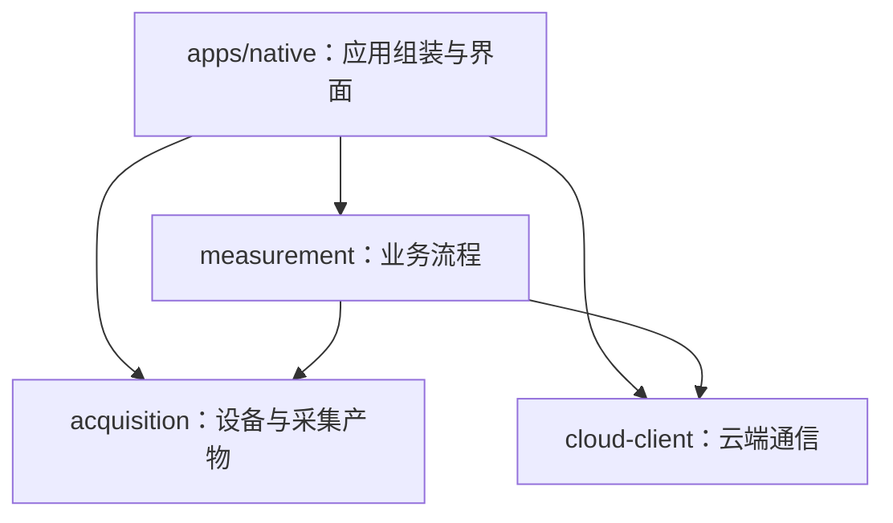

# 代码组织与模块边界

## 1. 文档范围与状态

本文记录 health-cv-app 当前确定的代码组织方案，作为后续实现和评审的依据。

项目是手机 App，通过摄像头、加速度计等传感器提取信号序列，保存为文件后多文件上传云端处理。CV 指心血管（cardiovascular）。本文规定代码组织、职责和依赖边界；技术选型状态见 [技术选型与实施边界](./technology-stack.md)，不在本文重复维护完整选型表，也不讨论健康指标算法或测量有效性。

当前确定的组织决策：

- 使用 React Native 和 TypeScript 实现 Native 应用。
- 使用 pnpm workspace，应用目录为 `apps/native`，暂不加入 WeApp。
- 设置 `measurement`、`acquisition`、`cloud-client` 三个功能包。
- 测量定义、流程编排和业务状态放在同一个业务包中，不独立建立 `domain`、`state`、`data` 或 `contracts` 包。
- Android 原生主动 PPG 由采集包的 Kotlin 实现，包含后摄像素处理、PPG 记录、有界批处理及双 CSV；无扰式被动录像由同包独立服务实现，只录制前摄视频，不复用 PPG 处理链。
- 主动 PPG 使用后摄；无扰式被动录像使用前摄和 Android 前台服务。`CameraUseGuard` 防止两种相机会话抢占或并行，这不表示所有原生采集都已后台化。
- 业务状态使用 Nano Stores，React 绑定只用于应用端；服务端查询与离散请求使用 React Query，真实 HTTP 通信使用 Axios。
- 云端接口按普通渠道 JSON API 和单文件传输组织；不接入实时网络传输或原始图像/视频上传。

目录图描述目标边界和部分实际模块的位置，不表示所有列出的目录或平台都已实现；当前能力与未实现范围按下文明确区分。

以下内容待验证或待定，不能从目录结构推断其已具备生产能力：

- Nitro 0.37.1、匹配的 Nitrogen 0.37.1 与 CameraX 1.6.2 已锁定；整体兼容性、最低系统版本和生产设备基线仍需验证。
- 本次 Android 后摄候选尺寸／帧率、PPG 八列字段、时间单位和经验提示阈值已确定；目标帧率、信号质量和提示准确性尚未验证。
- 除本次 PPG 外的采样参数、信号类型、颜色空间处理和跨传感器时钟映射。
- PPG 文件保留期限、应用异常退出后的处理方式和其它数据流需求。

已锁定的依赖版本、尚待确认的兼容性与未实施方向分别记录；目录示意不代表每个条目都已经接入或验证。

## 2. 整体目录

```text
health-cv-app/
├── apps/
│   └── native/
│       ├── src/
│       │   ├── app/
│       │   │   ├── App.tsx
│       │   │   ├── bootstrap.ts
│       │   │   ├── acquisition.ts
│       │   │   ├── sensors.ts
│       │   │   ├── auth/
│       │   │   ├── providers/
│       │   │   ├── navigation/
│       │   │   ├── query/
│       │   │   ├── i18n/
│       │   │   ├── preferences/
│       │   │   └── storage/
│       │   ├── features/
│       │   │   ├── entry/
│       │   │   │   ├── VerificationEntryScreen/
│       │   │   │   │   ├── index.tsx
│       │   │   │   │   └── styles.ts
│       │   │   │   └── EntryLink/index.tsx
│       │   │   ├── acquisition/
│       │   │   │   ├── AcquisitionScreen/
│       │   │   │   │   ├── index.tsx
│       │   │   │   │   └── styles.ts
│       │   │   │   ├── CameraQueryPanel/
│       │   │   │   │   ├── index.tsx
│       │   │   │   │   └── styles.ts
│       │   │   │   ├── CameraConfigurationEditor/
│       │   │   │   │   ├── index.tsx
│       │   │   │   │   └── styles.ts
│       │   │   │   ├── CameraConfigSummaryView/
│       │   │   │   │   ├── index.tsx
│       │   │   │   │   └── styles.ts
│       │   │   │   ├── PassiveCaptureScreen/
│       │   │   │   │   ├── index.tsx
│       │   │   │   │   └── styles.ts
│       │   │   │   └── acquisitionMessages.ts
│       │   │   ├── sensors/
│       │   │   │   └── SensorCaptureScreen/
│       │   │   │       ├── index.tsx
│       │   │   │       └── styles.ts
│       │   │   ├── settings/
│       │   │   │   ├── LanguageSettingsScreen/
│       │   │   │   │   ├── index.tsx
│       │   │   │   │   └── styles.ts
│       │   │   │   └── LanguageChoice/index.tsx
│       │   │   └── measurement/
│       │   │       ├── screens/
│       │   │       ├── components/
│       │   │       └── hooks/
│       │   └── shared/
│       │       ├── components/
│       │       │   ├── ActionButton/index.tsx
│       │       │   ├── AppCard/index.tsx
│       │       │   ├── AppInput/index.tsx
│       │       │   ├── AppText/index.tsx
│       │       │   ├── PageContainer/index.tsx
│       │       │   └── StatusFeedback/index.tsx
│       │       └── theme/
│       ├── assets/
│       ├── android/
│       ├── ios/
│       ├── app.config.ts
│       ├── metro.config.js
│       ├── package.json
│       └── tsconfig.json
├── packages/
│   ├── measurement/
│   │   ├── src/
│   │   │   ├── plans/
│   │   │   │   ├── types.ts
│   │   │   │   └── index.ts
│   │   │   ├── session/
│   │   │   │   ├── MeasurementSession.ts
│   │   │   │   ├── state.ts
│   │   │   │   └── types.ts
│   │   │   ├── result/
│   │   │   │   ├── types.ts
│   │   │   │   └── mapping.ts
│   │   │   ├── errors.ts
│   │   │   └── index.ts
│   │   ├── package.json
│   │   └── tsconfig.json
│   ├── acquisition/
│   │   ├── src/
│   │   │   ├── ppg/
│   │   │   │   └── client.ts
│   │   │   ├── passive/
│   │   │   │   └── client.ts
│   │   │   ├── sensors/
│   │   │   │   └── client.ts
│   │   │   ├── index.ts
│   │   │   ├── native/
│   │   │   │   ├── Acquisition.nitro.ts
│   │   │   │   ├── PassiveCapture.nitro.ts
│   │   │   │   ├── SensorCapture.nitro.ts
│   │   │   │   └── CameraPreview.nitro.ts
│   │   │   └── react/
│   │   │       └── CameraPreview.tsx
│   │   ├── android/src/main/java/
│   │   │   ├── com/healthcvapp/acquisition/
│   │   │   │   ├── bridge/
│   │   │   │   ├── camera/ownership/
│   │   │   │   ├── passive/
│   │   │   │   │   ├── capture/
│   │   │   │   │   ├── output/
│   │   │   │   │   ├── runtime/
│   │   │   │   │   ├── service/
│   │   │   │   │   └── trigger/
│   │   │   │   ├── pipeline/
│   │   │   │   ├── ppg/
│   │   │   │   │   ├── camera/
│   │   │   │   │   ├── correlation/
│   │   │   │   │   ├── model/
│   │   │   │   │   ├── output/
│   │   │   │   │   ├── pixels/
│   │   │   │   │   ├── processing/
│   │   │   │   │   ├── runtime/
│   │   │   │   │   └── session/
│       │       │   ├── sensors/
│       │       │   │   ├── model/
│       │       │   │   ├── output/
│       │       │   │   ├── runtime/
│       │       │   │   ├── session/
│       │       │   │   └── source/
│   │   │   │   └── storage/csv/
│   │   │   └── com/margelo/nitro/acquisition/
│   │   │       ├── HybridAcquisition.kt
│   │   │       ├── HybridCameraPreview.kt
│   │   │       ├── HybridSensorCapture.kt
│   │   │       └── HybridPassiveCapture.kt
│   │   ├── nitrogen/generated/
│   │   ├── nitro.json
│   │   ├── react-native.config.js
│   │   ├── package.json
│   │   └── tsconfig.json
│   └── cloud-client/
│       ├── src/
│       │   ├── http/
│       │   │   ├── client.ts
│       │   │   └── types.ts
│       │   ├── apis/
│       │   │   ├── auth.ts
│       │   │   ├── user.ts
│       │   │   ├── model.ts
│       │   │   └── task.ts
│       │   ├── errors.ts
│       │   ├── index.ts
│       │   └── types/
│       │       ├── dto/
│       │       │   ├── index.ts
│       │       │   ├── request.ts
│       │       │   └── response.ts
│       │       └── index.ts
│       ├── package.json
│       └── tsconfig.json
├── docs/
│   ├── architecture/
│   │   ├── code-organization.md
│   │   └── technology-stack.md
│   ├── acquisition/
│   └── development/
├── openspec/
├── package.json
├── pnpm-workspace.yaml
├── pnpm-lock.yaml
└── tsconfig.base.json
```

上述目录图展示当前 Android 采集包及应用端已落地模块，并保留尚未实施的测量业务目标结构；`apps/native` 的 `@/*` 映射到 `src/*`，跨模块引用使用该别名，组件目录以 `index.tsx` 为入口，styled-components 定义放在同目录 `styles.ts`。

## 3. 应用端：`apps/native`

### 3.1 应用组装：`src/app`

负责应用入口、导航、应用级 Provider、运行环境配置和依赖组装。

`bootstrap.ts` 使用显式云端配置组装云端客户端、认证会话和 QueryClient；缺少配置时只禁用云端服务，独立的采集入口仍可启动。

组装层只连接依赖，不实现测量流程，也不集中承载所有模块的初始化细节。模块自己的初始化逻辑仍由模块负责。

`providers/` 接入 React Query 和 styled-components/native 的 ThemeProvider。`navigation/` 使用单一 React Navigation native-stack，注册验证入口、主动 PPG、被动录像、传感器和语言设置路由，并统一解析 `healthcvapp://passive-capture` 深链。

`query/` 承载 QueryClient、服务端资源查询键和必要的请求接入。受保护缓存按服务地址、渠道和会话代次隔离；认证状态不复制账号或资料，也不让页面挂载成为会话恢复的前提。

`auth/` 管理注册、登录、启动恢复、受保护请求的共享刷新及本地退出。只读 Nano Stores 状态不保存令牌或密码；凭据适配器把令牌对作为单条记录存入 `expo-secure-store`，键按规范化服务地址和普通渠道隔离。认证请求不经过通用 Query/Mutation 缓存。

`i18n/` 管理语言来源、翻译与格式化；`preferences/` 管理持久化的用户偏好；`storage/` 只接入偏好存储引擎，不演变为包罗信号文件和网络的基础设施层。注册存储引擎后才创建 persistent Store，避免顶层导入造成初始化顺序错误。

`sensors.ts` 为四种 `SensorKind` 组装各自的 `SensorClient` 与低频 Nano Stores，不缓存样本，也不把页面订阅当作采集生命周期。

### 3.2 功能界面

界面按业务功能就近组织，不把全应用页面、组件和 Hook 分别堆在根级目录。

#### 页面组件

页面组件按功能放在 `src/features/<feature>/<ComponentName>/index.tsx`，负责布局、导航参数、交互入口和组件组合；styled-components 放在同目录 `styles.ts`。页面不决定所需采集源，不操作采集文件，不直接处理服务器响应，也不编排上传和结果处理步骤。

#### 功能组件

相机查询、配置编辑、状态与产物摘要等组件就近放在所属功能目录的同名目录中，只接收展示数据和操作回调。只有实际被其他功能复用的组件，才移入 `shared/components/<ComponentName>`；各组件入口均为 `index.tsx`，无 styled-components 的目录不创建空样式文件。

#### `hooks/`

通过 `@nanostores/react` 获取业务会话状态，转换低频展示属性，并提供开始、停止、取消等操作入口。必要的服务端查询与离散请求接入 React Query，不再自行包装一套 React 状态订阅。

Hook 可以管理弹窗、选中项等界面状态，但不决定必需信号、采集结束条件或后续上传行为。不通过增加薄包装 Hook 或桥接类来重复已有流程。

#### 原生采集验证界面：`src/features`

`acquisition/AcquisitionScreen` 负责主动 PPG 查询、草稿、预览、采集与产物展示。离开时由共享离页守卫等待进行中的相机命令及原生关闭／文件收尾；关闭失败保留当前页面和错误入口，不提前交接相机。`acquisition/PassiveCaptureScreen` 只提供显式被动服务启停与真实状态展示，页面切换不会停止仍归原生服务所有的会话。`sensors/SensorCaptureScreen` 展示四种 Android 默认传感器的能力、配置、低频状态、结构化错误和完成文件引用；页面订阅清理不会停止仍由原生会话拥有的采集。这些验证入口不编排测量业务。

### 3.3 已发生的复用：`src/shared`

初期承载已被实际复用的界面组件和主题。

不预建泛化的 `shared/services`、`shared/models` 或大而全的 `utils`。模块内部使用的工具留在该模块中。

使用 styled-components/native 时，样式与界面组件就近放置，主题对象和类型化 token 在 `shared/theme` 定义，由组件、SVG 与图表共用。首版 ThemeProvider 只提供浅色主题，不提供深色／跟随系统主题，也不预建主题偏好与切换状态。通用组件在实际复用后提升到 `shared/components`，不建立独立 UI 或 design-tokens 包。

功能文案跟随对应功能组织，公共语言来源与格式化在 `app/i18n` 管理。首发简体中文与英文，默认及回退语言为简体中文，系统语言只在用户选择跟随系统时参与解析。业务和原生模块返回错误码与参数，不保存已翻译的界面文案。图表组件管理实例与展示，不承担请求与流程编排；实时波形仅为后续可能能力，不预建占位接口，完整采样流不进入 JS 状态与缓存。样式、图标、图表、动画及文案的具体开发规则见 [前端开发约定](../development/frontend-development.md)。

### 3.4 资源与宿主工程

`assets/` 承载应用资源。

`android/` 和 `ios/` 是宿主工程，负责应用级原生配置，例如权限声明、应用标识、签名和模块接入。采集功能主体实现放在 `packages/acquisition`，不散落在宿主工程中。

使用 Expo development build 和 Prebuild / CNG；权限和宿主定制由配置与插件表达，不依赖重新生成时会丢失的手工修改。采集手写源码始终保留在功能包，不以生成的宿主工程作为唯一保存位置。

## 4. 测量业务：`packages/measurement`

该包是测量业务流程的唯一负责人，回答用户进行一次测量时系统应该做什么、何时进入下一步，以及产生什么业务结果。

它不包含 React 组件，不直接访问平台设备 API，也不处理底层 HTTP 细节。

### 4.1 测量方案：`src/plans`

定义当前产品实际需要的测量方案，包括：

- 所需采集源或信号。
- 用户准备动作。
- 采集时长与结束条件。
- 阻止业务继续的采集事实。
- 对应的云端处理类型。

业务要求与平台实现参数分开：业务可以要求采集模式和目标采样能力；具体相机格式选择、曝光配置和平台 API 调用由 `acquisition` 实现。

不复制参考项目中与当前产品无关的模型目录，也不提前建立通用降级策略或可配置流程引擎。

### 4.2 业务会话：`src/session`

`MeasurementSession` 编排一次测量，包括准备条件检查、启动采集、低频进度接收、停止并取得完成的信号文件、多文件上传、结果接收和用户取消。当前不编排边采集边网络传输。

`state.ts` 与流程实现放在一起，使用 Nano Stores 直接定义权威业务状态，由 `MeasurementSession` 推进。它不作为独立的通用状态包发布，对页面只提供读取和订阅，通过业务命令修改；派生状态使用 `computed`，不同时保存内部状态和同步 Store 两套副本。

测量业务只维护一套权威状态，不通过 `DomainStateBridge` 连接两套相近的业务状态机。采集模块可以拥有必要的设备运行状态，但不得同时负责判断整个测量业务是否成功。

采集完成、上传完成和云端处理完成是不同事实。采集结束时尚无云端结果，不应直接被判为结果缺失失败；业务成功也不能只依据采集成功。

具体阶段及转换条件随真实采集流程和服务器协议确定，不先枚举没有实际需求的状态组合。

业务核心只依赖 Nano Stores 核心，不依赖 `@nanostores/react`、React Query Hook 或 Axios。请求状态和业务阶段分别拥有明确负责人，不能将 Query Cache 中的请求状态再完整镜像到业务 Store。

### 4.3 业务结果：`src/result`

定义应用理解的测量结果，并将云端客户端返回的数据映射为业务结果。

服务器原始 DTO 属于 `cloud-client`，报告颜色、布局和界面提示属于应用端。两者不放入业务结果模型。

### 4.4 业务状态的数据范围

业务状态可以保留当前阶段、进度、低频采集统计、可操作性、错误、采集产物引用和最终结果。

不得保留全量图像帧、逐个运动样本、不断增长的信号块数组或原生设备对象。波形预览使用独立、受控的预览数据通道，不通过业务状态累积完整数据。

## 5. 设备采集：`packages/acquisition`

该包负责 Android 主动后摄 PPG 采集，以及独立的前摄被动视频服务；前者处理像素、Camera2 元数据、PPG 数据和双 CSV，后者只管理解锁触发、视频录制及私有视频产物。

不另建一个只有采集协议的包，再把实际采集代码分散放入应用端。

### 5.1 调用入口：主动与被动客户端

`src/ppg/client.ts` 的 `AcquisitionClient` 封装主动 PPG 状态、权限、后摄预览／采集和双文件产物；`src/passive/client.ts` 的 `PassiveCaptureClient` 只封装被动采集配置、启停、低频状态与视频引用。原生桥接细节不暴露给应用流程。

### 5.2 数据语义：Nitro 低频接口

主动 PPG 类型由 `src/native/Acquisition.nitro.ts` 定义；被动接口由 `src/native/PassiveCapture.nitro.ts` 定义：

- 主动 PPG 快照提供后摄状态、结构化错误、实际帧尺寸／帧率、torch 能力、nullable 经验提示和双 CSV 产物。
- 被动接口提供配置、真实服务状态、最近原因与完成视频引用；视频只通过私有文件路径和媒体元数据引用，不把视频字节或帧传给 JavaScript。
- 两种 Nitro 接口只提供异步控制、低频快照与状态监听，不定义或传输像素、PPG 样本、逐帧元数据或记录批次。

若以后新增外部采集数据，必须明确通道、区域、单位、时间基准和缺失字段语义；不能仅用无法解释的 `number[]` 表示。

请求帧率和实际测量帧率分开记录。数据结构有效不等于信号质量合格；尚未评估的提示明确为 `null`，不填固定高分或伪造通过状态。

### 5.3 原生实现：`android/`

原生源码留在 `packages/acquisition/android`，由 Nitro 对象接入；CNG 宿主工程只维护应用权限和模块自动链接。

- `camera/ownership/`、`ppg/camera/`：`camera/ownership/` 提供主动 PPG 与被动录像共用的相机占用保护；`ppg/camera/` 封装主动 PPG 的 CameraX 后摄预览与帧分析。
- `ppg/pixels/`、`ppg/processing/`：主动 PPG 的只读 YUV 帧借用、共享统计、记录转换和经验提示；被动视频不进入这些路径，当前没有被动像素或人脸筛选。
- `pipeline/` 提供有界 `DataHub<T>`；`ppg/correlation/`、`ppg/session/`、`ppg/output/`、`storage/csv/` 负责主动 PPG 元数据配对、会话收尾、双 CSV 编码和有序写入。
- `storage/`：`AcquisitionPaths` 集中维护主动 PPG 与被动视频路径；`AcquisitionFileStore` 负责目录、新建拒覆盖输出和单文件提升，不接管媒体检查、双文件发布或清理策略。
- `passive/runtime/`、`passive/service/`、`passive/trigger/`、`passive/capture/` 分别负责应用控制与状态、前台服务与通知、周期门控及录像生命周期；`passive/output/PassiveVideoArtifactStore` 负责媒体检查、发布、取消片段清理和完成文件扫描，并使用 `storage/` 的共通路径及文件操作。被动链不创建 `DataHub<T>` 或 PPG CSV。
- `ppg/runtime/`、`bridge/`：`PPGRuntime` 共享进程级 `PPGController`；控制器串行化主动 PPG 命令，并维护预览元数据缓存、活动会话、低频状态／提示与结构化错误；`bridge/` 封装 Nitro 控制对象。

`sensors/model/` 定义类型、配置、样本和产物；`sensors/source/` 通过受控线程封装 `SensorManager`；`sensors/session/` 与 `sensors/output/` 管理原生回调窗口、有界 `DataHub`、六列表头编码和单文件发布；`sensors/runtime/` 按类型维护唯一控制器并处理宿主前台边界。源失败只终止对应传感器；共同宿主暂停／销毁会中断全部活动源，但不是跨源失败级联。

### 5.4 高频数据与时间

主动 PPG 的高频相机帧、像素处理、记录、Camera2 元数据关联和文件写入都在 Android 原生侧。被动视频不向 JavaScript 传递帧或媒体字节；传感器样本与 CSV 写入也留在原生。JavaScript 只接收启停结果、低频状态、结构化错误及完成产物引用。

`DataHub<T>` 按数据流／会话独立实例化，容量包含等待消费和正在消费的记录；数量与时间阈值只触发单个后台消费者，不在相机或传感器回调中执行文件 I/O。容量不足、处理或写入失败会终止对应采集成功路径，不能静默丢记录。

当前每帧一个全帧 PPG 块，`blockIndex=0`。`timestamp` 是处理帧时的 `elapsedRealtimeNanos`，`timestampFrame` 是 CameraX 帧时间，`timestampSystem` 是 `System.nanoTime()`；均以毫秒小数写入，`timestampSystem` 不是 Unix 日期。正式会话以处理帧的单调接收边界排除开始前帧。

主动 PPG 与运动传感器各自保留单调时钟；当前未定义相机与传感器之间的跨源时钟对齐，不宣称其记录可直接按时间戳同步。经验提示不表示覆盖面积、信号质量或医学结论。

#### Camera2 元数据配对与双文件

预览阶段，`PPGController` 在原生侧最多保留 64 条含 `SENSOR_TIMESTAMP` 的 Camera2 数值结果，并在正式会话启用时交接，用于匹配回调先到、图像仍在途的帧。`FrameMetadataCorrelator` 只按 `SENSOR_TIMESTAMP == ImageProxy.imageInfo.timestamp` 精确关联，按正式帧序交付，并在容量溢出、时间戳缺失或正式帧无法匹配时失败。关联等待有界，不延长 `ImageProxy` 生命周期。

`frame.csv` 沿用旧八列表头：`timestamp`、`timestampFrame`、`timestampSystem` 以毫秒小数记录，三项相机时长保持纳秒，ISO 和白平衡模式保留整数。可选结果缺失时写 `0`，因此无法区分缺失与真实零值；缺少用于配对的传感器时间戳则失败。


### 5.5 React 视图接入：`src/react`

`CameraPreview.tsx` 仅接入摄像头预览视图，支持并正确传递标准 `style` 属性，不包含业务引导、倒计时、上传或结果展示。

通过独立的 `acquisition/react` 公开入口提供视图接入。业务流程使用核心采集入口，不依赖预览组件。

### 被动采集页面与服务边界

`apps/native/src/features/acquisition/PassiveCaptureScreen.tsx` 负责用途说明、权限与配置入口、低频运行状态和视频引用展示。`PassiveCaptureClient` 负责权限请求、配置、启停、视频查询和状态订阅；页面卸载只解除订阅，不替代原生服务的显式关闭操作。

被动服务仅在用户启用且系统条件满足后等待 `USER_PRESENT`，周期到期时直接录制前摄视频。等待时不打开相机；录像不创建预览或 `ImageAnalysis`，不录音、不做人脸／像素筛选、不计算 PPG。视频留在应用私有目录，不由采集模块自动上传或清理。

主动 PPG 仍是页面发起的后摄预览与 PPG／CSV 会话。两种模式通过 `CameraUseGuard` 拒绝相机并发；被动录像占用时，主动页面显示忙状态，不抢占被动会话。此隔离不意味着主动 PPG 已可在后台运行。


### 5.6 产物与资源的生命周期

停止采集、释放运行资源和删除采集产物是不同操作：

- 正常停止等待 PPG 帧关联与 DataHub 尾批、两个 writer 关闭后才交付双文件产物；传感器停止等待监听注销、在途回调和本源尾批结束，关闭 writer 后才发布单文件产物。
- 释放摄像头、传感器和队列等运行资源。
- 根据业务明确的保留策略删除采集文件。

### 5.7 文件管理与扩展边界

`PPGCaptureSession` 保留正式帧边界和在途屏障；配对记录交由 `PPGSessionOutput`，再由两侧 `CsvBatchWriter<PPGCaptureRecord>` 使用 `PPGCsvEncoder` 与 `FrameCsvEncoder` 顺序写入。输出层关闭两侧后协调单文件提升与失败回退；任一侧失败都不返回成功产物。

`AcquisitionPaths` 保持既有 PPG `filesDir/acquisition/<sessionId>/` 与被动视频 `filesDir/passive-capture/<sessionId>/` 路径；传感器文件使用隔离的 `filesDir/acquisition/sensors/<kind>/<sessionId>/<kind>.csv(.part)`。已有文件不迁移、不自动删除。

主动 PPG 与传感器的 `listArtifacts()` 只返回当前进程内已完成引用，不扫描磁盘；进程重启后的传感器查询列表重置，但已完成 CSV 仍留在私有目录。被动视频使用独立目录扫描，应用重开后仍可查询。所有页面只展示引用，不直接读写或删除会话文件，也不接入上传 URI。

待上传或仍需保留的文件放应用私有持久目录，不默认依赖可能被系统清理的缓存目录。正在写入或上传的文件不得清理。文件系统路径与上传 URI 分开处理，删除时机由测量业务决定。

信号提取与文件写入保持职责分离，保留批次顺序与时间语义，供后续流式消费者接入。当前只接文件保存，不创建占位 StreamingClient、空方法、通用消费框架或无行为开关。

## 6. 云端通信：`packages/cloud-client`

该包封装普通渠道的认证、本人账号与资料、模型目录、任务及文件接口；不承载应用认证状态、服务端缓存或业务流程编排。

### 6.1 通信基础能力：`src/http`

Axios 负责请求执行、超时、取消和 HTTP/JSON 边界。调用方提供不含 `/api/v1` 的 HTTP(S) 服务根地址及普通渠道；客户端统一追加 `/api/v1/{channel}`。请求拦截器从外部回调读取当前 Access Token 并发送 Bearer，认证入口不读取 Access；响应拦截器解包成功 JSON 并映射结构化错误。传输层不刷新、重试、轮询或保存缓存。
JSON 请求仅在 HTTP 成功、`code=OK` 且包装包含 `data` 时返回 `data`，保留合法 `null`。业务 DTO 字段不执行运行时校验；失败通过 `CloudClientError` reject，并分别提供错误类别、HTTP 状态、业务码、请求标识和 `Retry-After`；不保留 Axios 请求配置或原始响应。

### 6.2 普通渠道资源：`auth`、`users`、`models`、`tasks`

资源实现集中在 `src/apis/auth.ts`、`src/apis/user.ts`、`src/apis/model.ts`、`src/apis/task.ts`；每个公开方法只执行一个对应的后端请求。`auth` 提供注册、登录、刷新和登出；`users` 提供本人账号和资料读写；`models` 提供普通渠道目录；`tasks` 提供草稿、列表、详情、单文件上传、提交及输入/输出下载。
请求/响应 DTO 集中定义在 `types/dto/request.ts` 和 `types/dto/response.ts`，由包根 `Req`、`Rsp` 命名空间导出；资源 API 按职责分组，不复制局部 DTO 或业务字段解析器。

文件上传一次只发送一个 `logicalName` 与一个文件引用，由 React Native 运行时生成 multipart boundary。多输入任务由调用方逐文件调用，不在通信包内串联创建、上传、提交或查询。

通信包确认传输和响应协议，不决定任务何时成功，不处理页面提示、路由或文件保留策略。文件下载返回二进制载荷和可取得的响应元信息，不负责落盘。

React Query、Nano Stores 和 React 绑定留在应用端。云端包不依赖 React、Store 或 Query Cache，也不保存完整信号序列。

## 7. 依赖方向与公开接口



`measurement` 通过必要的 TypeScript 接口接收采集客户端和云端客户端，真实实现由应用组装层传入。只为实际外部能力保留接口，不建立万能 `Port` 体系。业务核心可以依赖 Nano Stores 核心，但不因引用接口加载 React 绑定、Axios 或设备运行时。

`acquisition` 和 `cloud-client` 不依赖 `measurement`，也不互相管理对方的生命周期。测量业务负责连接采集产物与云端调用，并转换两侧的数据。

包之间只使用公开入口，不从其他包的 `src` 深层路径导入。内部实现保持私有，不为方便调用而全部导出。

类型跟随拥有该概念的包：业务定义属于 `measurement`，采集配置和产物属于 `acquisition`，通信 DTO 属于 `cloud-client`，展示属性属于应用端。不建立中央类型仓库，也不重复定义同一个业务概念。

国际化与偏好持久化属于应用端；Nano Stores 管理可订阅的认证状态，React Query 管理按会话隔离的服务端资源，`expo-secure-store` 保存按服务地址/渠道作用域划分的令牌对，MMKV 仅用于普通偏好。文件管理、Nitro 和生成接口归采集包，Axios 归云端包。

目录边界优先。只有存在独立复用、发布或构建需求时才继续拆包，代码量增加本身不构成拆包理由。

## 8. 文档与验证组织

`docs/architecture` 记录架构与模块边界；`docs/acquisition` 记录采集数据协议、配置和能力约束；`docs/development` 记录应用开发约定、构建和真机运行方式。

`openspec` 保留规格与变更流程材料，不代替长期架构和开发说明。

`technology-stack.md` 维护已明确选型、待定事项和实施边界；本文维护职责与依赖；[前端开发约定](../development/frontend-development.md) 维护 UI、数据流、缓存和国际化的具体使用规则。修改时同步受影响内容与相互链接，不将目录示意或开发约定视为已实现功能。

验证围绕真实业务和实现就近组织，不要求每个包建立固定的 `contract-check`。优先关注完整采集、产物可读、真实文件上传、正常停止、用户取消和资源释放等实际风险。

外部服务器响应和原生数据保留必要校验；内部静态配置不层层重复运行时校验。不为证明接口存在、字段转发或返回 `Promise` 建立测试，也不重复维护多套依赖隔离扫描脚本。

不为减少验证而删除正常使用中必须处理的取消、资源中断、数据保存失败等行为。验证辅助代码不应反过来决定业务模型和生产模块边界。

## 9. 当前不加入的结构

- WeApp 或其他尚无明确需求的客户端。
- 独立的 `domain`、`state`、`data`、`contracts` 包。
- 跨端 UI 包和独立 design-tokens 包。
- 通用业务状态机引擎、事件总线或降级框架。
- 没有实际使用方的共享模块和占位实现。
- 同一采集功能的第二套原生绑定入口、未使用的 VisionCamera 路径或占位流式实现。

后续先定义真实测量流程与采集产物，再确定包接口并实现主链路。只有业务或运行边界发生实际变化时，才调整本组织方案。
