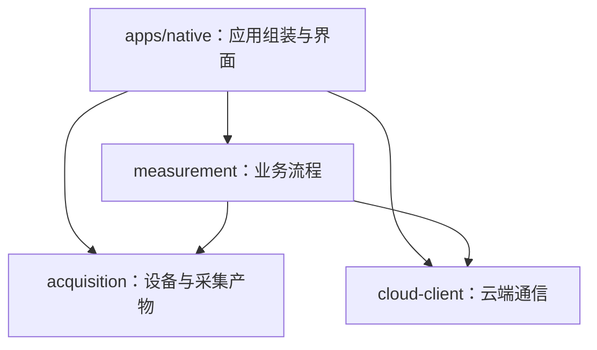

# 代码组织与模块边界

## 1. 文档范围与状态

本文记录 health-cv-app 当前确定的代码组织方案，作为后续实现和评审的依据。

项目是手机 App，通过摄像头、加速度计等传感器提取信号序列，保存为文件后多文件上传云端处理。CV 指心血管（cardiovascular）。本文规定代码组织、职责和依赖边界；技术选型状态见 [技术选型与实施边界](./technology-stack.md)，不在本文重复维护完整选型表，也不讨论健康指标算法或测量有效性。

当前确定的组织决策：

- 使用 React Native 和 TypeScript 实现 Native 应用。
- 使用 pnpm workspace，应用目录为 `apps/native`，暂不加入 WeApp。
- 设置 `measurement`、`acquisition`、`cloud-client` 三个功能包。
- 测量定义、流程编排和业务状态放在同一个业务包中，不独立建立 `domain`、`state`、`data` 或 `contracts` 包。
- 摄像头帧处理、高频运动传感器采集、缓冲和数据写入由采集模块的原生实现负责。
- 自建相机与运动传感器采集模块，使用 Nitro 对外接入；前后摄像头不同时采集。
- 业务状态使用 Nano Stores，React 绑定只用于应用端；服务端查询与离散请求使用 React Query，真实 HTTP 通信使用 Axios。
- 云端接口按普通渠道 JSON API 和单文件传输组织；不接入实时网络传输或原始图像/视频上传。

本文描述目标结构，不代表这些目录、接口或功能已经实现。目录和文件在对应功能实际实现时创建，不预建空目录、占位实现或没有使用方的公共模块。

以下内容尚未确定，不能从目录结构推断其选型或行为：

- 已选技术的具体版本与兼容组合、最低系统版本和设备能力基线。
- 采样率、分辨率、曝光、采集时长、区域、通道及平均规则。
- 信号精度、时间协议、批次与文件格式，以及覆盖检测指标和阈值。
- 缓冲池容量、回收与背压规则，以及各环节延迟目标。
- 产物具体目录、保留时长、删除条件及网络和应用中断时的业务行为。

已明确的技术选型与待定的版本、协议和行为分别记录；目录示意不代表已经接入或验证。

## 2. 整体目录

```text
health-cv-app/
├── apps/
│   └── native/
│       ├── src/
│       │   ├── app/
│       │   │   ├── App.tsx
│       │   │   ├── bootstrap.ts
│       │   │   ├── auth/
│       │   │   ├── providers/
│       │   │   ├── navigation/
│       │   │   ├── query/
│       │   │   ├── i18n/
│       │   │   ├── preferences/
│       │   │   └── storage/
│       │   ├── features/
│       │   │   └── measurement/
│       │   │       ├── screens/
│       │   │       ├── components/
│       │   │       └── hooks/
│       │   └── shared/
│       │       ├── components/
│       │       └── theme/
│       ├── assets/
│       ├── android/
│       ├── ios/
│       ├── app.config.ts
│       ├── metro.config.js
│       ├── package.json
│       └── tsconfig.json
├── packages/
│   ├── measurement/
│   │   ├── src/
│   │   │   ├── plans/
│   │   │   │   ├── types.ts
│   │   │   │   └── index.ts
│   │   │   ├── session/
│   │   │   │   ├── MeasurementSession.ts
│   │   │   │   ├── state.ts
│   │   │   │   └── types.ts
│   │   │   ├── result/
│   │   │   │   ├── types.ts
│   │   │   │   └── mapping.ts
│   │   │   ├── errors.ts
│   │   │   └── index.ts
│   │   ├── package.json
│   │   └── tsconfig.json
│   ├── acquisition/
│   │   ├── src/
│   │   │   ├── client.ts
│   │   │   ├── types/
│   │   │   │   ├── config.ts
│   │   │   │   ├── capability.ts
│   │   │   │   ├── samples.ts
│   │   │   │   ├── coverage.ts
│   │   │   │   └── artifact.ts
│   │   │   ├── native/
│   │   │   │   └── Acquisition.nitro.ts
│   │   │   ├── react/
│   │   │   │   └── CameraPreview.tsx
│   │   │   ├── artifacts/
│   │   │   │   └── files.ts
│   │   │   ├── errors.ts
│   │   │   └── index.ts
│   │   ├── android/
│   │   ├── ios/
│   │   ├── nitro.json
│   │   ├── nitrogen/
│   │   │   └── generated/
│   │   ├── package.json
│   │   └── tsconfig.json
│   └── cloud-client/
│       ├── src/
│       │   ├── http/
│       │   │   ├── client.ts
│       │   │   └── types.ts
│       │   ├── apis/
│       │   │   ├── auth.ts
│       │   │   ├── user.ts
│       │   │   ├── model.ts
│       │   │   └── task.ts
│       │   ├── errors.ts
│       │   ├── index.ts
│       │   └── types/
│       │       ├── dto/
│       │       │   ├── index.ts
│       │       │   ├── request.ts
│       │       │   └── response.ts
│       │       └── index.ts
│       ├── package.json
│       └── tsconfig.json
├── docs/
│   ├── architecture/
│   │   ├── code-organization.md
│   │   └── technology-stack.md
│   ├── acquisition/
│   └── development/
├── openspec/
├── package.json
├── pnpm-workspace.yaml
├── pnpm-lock.yaml
└── tsconfig.base.json
```

上图是目标职责布局，不要求手工创建所有目录和文件。构建配置、宿主工程和 Nitro 生成代码按实际工具链管理；已选定的配套库只规定其应归属的位置，不代表已经接入。

## 3. 应用端：`apps/native`

### 3.1 应用组装：`src/app`

负责应用入口、导航、应用级 Provider、运行环境配置和依赖组装。

`bootstrap.ts` 使用 `EXPO_PUBLIC_API_BASE_URL` 与 `EXPO_PUBLIC_CHANNEL` 显式组装云端客户端、认证会话服务、安全凭据适配器和 QueryClient；应用模块初始化时启动一次恢复，不依赖页面挂载。配置缺失时不推断服务地址或渠道。

组装层只连接依赖，不实现测量流程，也不集中承载所有模块的初始化细节。模块自己的初始化逻辑仍由模块负责。

`providers/` 接入 React Query 和 styled-components/native 的 ThemeProvider。`navigation/` 使用 React Navigation 承载路由。

`query/` 承载 QueryClient、服务端资源查询键和必要的请求接入。受保护缓存按服务地址、渠道和会话代次隔离；认证状态不复制账号或资料，也不让页面挂载成为会话恢复的前提。

`auth/` 管理注册、登录、启动恢复、受保护请求的共享刷新及本地退出。只读 Nano Stores 状态不保存令牌或密码；凭据适配器把令牌对作为单条记录存入 `expo-secure-store`，键按规范化服务地址和普通渠道隔离。认证请求不经过通用 Query/Mutation 缓存。

`i18n/` 管理语言来源、翻译与格式化；`preferences/` 管理持久化的用户偏好；`storage/` 只接入偏好存储引擎，不演变为包罗信号文件和网络的基础设施层。注册存储引擎后才创建 persistent Store，避免顶层导入造成初始化顺序错误。

### 3.2 功能界面：`src/features/measurement`

界面按业务功能就近组织，不把全应用页面、组件和 Hook 分别堆在根级目录。

#### `screens/`

负责页面布局、导航参数、交互入口和组件组合。

页面不决定所需采集源，不操作采集文件，不直接处理服务器响应，也不编排停止、上传和结果处理步骤。

#### `components/`

负责测量功能自己的操作引导、摄像头区域、波形、进度和结果展示。

组件只接收展示数据和操作回调。只有实际被其他功能复用的组件，才移入 `shared/components`。

#### `hooks/`

通过 `@nanostores/react` 获取业务会话状态，转换低频展示属性，并提供开始、停止、取消等操作入口。必要的服务端查询与离散请求接入 React Query，不再自行包装一套 React 状态订阅。

Hook 可以管理弹窗、选中项等界面状态，但不决定必需信号、采集结束条件或后续上传行为。不通过增加薄包装 Hook 或桥接类来重复已有流程。

### 3.3 已发生的复用：`src/shared`

初期承载已被实际复用的界面组件和主题。

不预建泛化的 `shared/services`、`shared/models` 或大而全的 `utils`。模块内部使用的工具留在该模块中。

使用 styled-components/native 时，样式与界面组件就近放置，主题对象在 `shared/theme` 定义。主题偏好由应用 Store 管理，ThemeProvider 只消费实际主题，不保存第二份主题选择状态。

功能文案跟随对应功能组织，公共语言来源与格式化在 `app/i18n` 管理。业务和原生模块返回错误码与参数，不保存已翻译的界面文案。高频波形与连续动画的渲染工具后续按需求选定，不通过逐帧重建样式实现。

### 3.4 资源与宿主工程

`assets/` 承载应用资源。

`android/` 和 `ios/` 是宿主工程，负责应用级原生配置，例如权限声明、应用标识、签名和模块接入。采集功能主体实现放在 `packages/acquisition`，不散落在宿主工程中。

使用 Expo development build 和 Prebuild / CNG；权限和宿主定制由配置与插件表达，不依赖重新生成时会丢失的手工修改。采集手写源码始终保留在功能包，不以生成的宿主工程作为唯一保存位置。

## 4. 测量业务：`packages/measurement`

该包是测量业务流程的唯一负责人，回答用户进行一次测量时系统应该做什么、何时进入下一步，以及产生什么业务结果。

它不包含 React 组件，不直接访问平台设备 API，也不处理底层 HTTP 细节。

### 4.1 测量方案：`src/plans`

定义当前产品实际需要的测量方案，包括：

- 所需采集源或信号。
- 用户准备动作。
- 采集时长与结束条件。
- 阻止业务继续的采集事实。
- 对应的云端处理类型。

业务要求与平台实现参数分开：业务可以要求采集模式和目标采样能力；具体相机格式选择、曝光配置和平台 API 调用由 `acquisition` 实现。

不复制参考项目中与当前产品无关的模型目录，也不提前建立通用降级策略或可配置流程引擎。

### 4.2 业务会话：`src/session`

`MeasurementSession` 编排一次测量，包括准备条件检查、启动采集、低频进度接收、停止并取得完成的信号文件、多文件上传、结果接收和用户取消。当前不编排边采集边网络传输。

`state.ts` 与流程实现放在一起，使用 Nano Stores 直接定义权威业务状态，由 `MeasurementSession` 推进。它不作为独立的通用状态包发布，对页面只提供读取和订阅，通过业务命令修改；派生状态使用 `computed`，不同时保存内部状态和同步 Store 两套副本。

测量业务只维护一套权威状态，不通过 `DomainStateBridge` 连接两套相近的业务状态机。采集模块可以拥有必要的设备运行状态，但不得同时负责判断整个测量业务是否成功。

采集完成、上传完成和云端处理完成是不同事实。采集结束时尚无云端结果，不应直接被判为结果缺失失败；业务成功也不能只依据采集成功。

具体阶段及转换条件随真实采集流程和服务器协议确定，不先枚举没有实际需求的状态组合。

业务核心只依赖 Nano Stores 核心，不依赖 `@nanostores/react`、React Query Hook 或 Axios。请求状态和业务阶段分别拥有明确负责人，不能将 Query Cache 中的请求状态再完整镜像到业务 Store。

### 4.3 业务结果：`src/result`

定义应用理解的测量结果，并将云端客户端返回的数据映射为业务结果。

服务器原始 DTO 属于 `cloud-client`，报告颜色、布局和界面提示属于应用端。两者不放入业务结果模型。

### 4.4 业务状态的数据范围

业务状态可以保留当前阶段、进度、低频采集统计、可操作性、错误、采集产物引用和最终结果。

不得保留全量图像帧、逐个运动样本、不断增长的信号块数组或原生设备对象。波形预览使用独立、受控的预览数据通道，不通过业务状态累积完整数据。

## 5. 设备采集：`packages/acquisition`

该包负责设备能力、采集执行、时间语义、数据缓冲和产物生成，同时包含 TypeScript 接口与 iOS、Android 原生实现。

不另建一个只有采集协议的包，再把实际采集代码分散放入应用端。

### 5.1 调用入口：`src/client.ts`

封装能力探测、权限操作、配置、开始、停止和取消等必要采集操作。原生桥接细节不暴露给业务流程。

不在此重建完整的测量业务状态机或通用事件框架。

### 5.2 数据语义：`src/types`

- `config.ts`：采集源、相机和运动传感器配置。
- `capability.ts`：设备支持的能力及限制。
- `samples.ts`：图像提取数据、运动样本及其时间和单位。
- `artifact.ts`：采集文件、清单与统计信息。
- `coverage.ts`：实时手指覆盖反馈的指标与状态，具体含义和阈值待定。

采集数据必须明确颜色通道、区域或分块含义、坐标轴、单位、时间基准及缺失字段语义，不能仅用无法解释的 `number[]` 表示。

请求帧率和实际帧率分开记录。数据结构有效不等于信号质量合格；尚未评估的质量明确表示未评估，不填固定高分或伪造通过状态。

### 5.3 原生实现：`android/` 与 `ios/`

Android 使用 Kotlin、CameraX 和 SensorManager；iOS 使用 Swift、AVFoundation 和 Core Motion。前后摄像头分阶段使用，不采用 VisionCamera 作为本阶段采集实现。两端按相同职责组织，平台实现不强行统一：

- camera：相机选择、参数控制、帧回调与帧数据提取。
- motion：加速度计等运动传感器采集。
- session：设备启动、停止和运行资源管理。
- pipeline：缓冲、批处理与数据写入。
- time：时间戳与时钟映射。
- bridge：原生实现与 TypeScript 接口连接。

这些是职责边界，不要求每个职责形成独立库。`src/native` 维护 Nitro Spec 和接入代码，Nitrogen 生成的绑定归本包按构建要求管理。生成的 C++ 绑定不等于手写公共 C++ 处理层，暂不为使用 Nitro 提前迁移全部处理代码。

### 5.4 高频数据与时间

高频采集、帧处理、缓冲和文件写入在原生侧执行。帧信号逐帧或按多行平均后输出，具体规则待定；JS 接收信号批次、低频进度、统计、预览和产物引用，不接收原样图像，也不承担全量样本的长期缓存和最终文件序列化。

缓冲容量按当前待处理数据计算，累计采集统计不能代替缓冲占用。停止时处理尾批数据；会话结束后的迟到回调不能进入下一次采集。

信号批次通过异步回调传递，明确会话、顺序和采集时间。使用共享缓冲时，在消费者释放前不得覆盖数据；回调返回不等于缓冲可回收。容量、触发条件、回收协议和池满行为后续确定，不能以静默丢样本掩盖消费积压。

采集时间与回调接收时间分开。信号对齐使用经过确认和映射的单调时间轴；墙上时间用于记录采集发生的日期和时间，不用于代替原始样本时间。

摄像头与运动传感器都使用单调时钟，不代表已经同步。时钟关系需要验证；帧数据与逐帧元数据通过明确的帧标识或采集时间关联，不依赖批次到达顺序。

预览可以降采样，但不能因此改变保存和上传的数据。

手指覆盖检测在原生侧产生反馈，独立于信号批次和文件完成通知，不等待缓存池填满。检测在必要空间信息丢失前进行，可复用同一次帧处理中的区域统计，但不能假定平均值足以推断覆盖面积。覆盖通知可合并最新状态，不积压历史提示；算法和阈值需后续真机验证。

方法调用延迟、帧处理延迟和界面反馈延迟分别验证。Nitro 的低调用开销不替代正确的队列调度，不能从相机线程强行同步调用主 JS 逻辑。

### 5.5 React 视图接入：`src/react`

`CameraPreview.tsx` 仅接入摄像头预览视图，支持并正确传递标准 `style` 属性，不包含业务引导、倒计时、上传或结果展示。

通过独立的 `acquisition/react` 公开入口提供视图接入。业务流程使用核心采集入口，不依赖预览组件。

### 5.6 产物与资源的生命周期

停止采集、释放运行资源和删除采集产物是不同操作：

- 停止采集后处理尾批数据，完成并关闭文件，生成可上传的产物。
- 释放摄像头、传感器和队列等运行资源。
- 根据业务明确的保留策略删除采集文件。

释放运行资源不得隐式删除刚生成的文件。产物交给测量流程后，采集模块不得自行使其失效。上传完成或用户放弃后的删除条件，在数据保留策略确定后落实。

### 5.7 文件管理与扩展边界

连续写入使用平台原生文件 API，直接消费原生信号缓冲；具体格式和实现后续确定。`src/artifacts/files.ts` 负责产物相关的低频文件管理，使用 react-native-file-access 接入目录、查询、移动和删除操作，不把文件依赖散落到页面。

待上传或仍需保留的文件放应用私有持久目录，不默认依赖可能被系统清理的缓存目录。正在写入或上传的文件不得清理。文件系统路径与上传 URI 分开处理，删除时机由测量业务决定。

信号提取与文件写入保持职责分离，保留批次顺序与时间语义，供后续流式消费者接入。当前只接文件保存，不创建占位 StreamingClient、空方法、通用消费框架或无行为开关。

## 6. 云端通信：`packages/cloud-client`

该包封装普通渠道的认证、本人账号与资料、模型目录、任务及文件接口；不承载应用认证状态、服务端缓存或业务流程编排。

### 6.1 通信基础能力：`src/http`

Axios 负责请求执行、超时、取消和 HTTP/JSON 边界。调用方提供不含 `/api/v1` 的 HTTP(S) 服务根地址及普通渠道；客户端统一追加 `/api/v1/{channel}`。请求拦截器从外部回调读取当前 Access Token 并发送 Bearer，认证入口不读取 Access；响应拦截器解包成功 JSON 并映射结构化错误。传输层不刷新、重试、轮询或保存缓存。
JSON 请求仅在 HTTP 成功、`code=OK` 且包装包含 `data` 时返回 `data`，保留合法 `null`。业务 DTO 字段不执行运行时校验；失败通过 `CloudClientError` reject，并分别提供错误类别、HTTP 状态、业务码、请求标识和 `Retry-After`；不保留 Axios 请求配置或原始响应。

### 6.2 普通渠道资源：`auth`、`users`、`models`、`tasks`

资源实现集中在 `src/apis/auth.ts`、`src/apis/user.ts`、`src/apis/model.ts`、`src/apis/task.ts`；每个公开方法只执行一个对应的后端请求。`auth` 提供注册、登录、刷新和登出；`users` 提供本人账号和资料读写；`models` 提供普通渠道目录；`tasks` 提供草稿、列表、详情、单文件上传、提交及输入/输出下载。
请求/响应 DTO 集中定义在 `types/dto/request.ts` 和 `types/dto/response.ts`，由包根 `Req`、`Rsp` 命名空间导出；资源 API 按职责分组，不复制局部 DTO 或业务字段解析器。

文件上传一次只发送一个 `logicalName` 与一个文件引用，由 React Native 运行时生成 multipart boundary。多输入任务由调用方逐文件调用，不在通信包内串联创建、上传、提交或查询。

通信包确认传输和响应协议，不决定任务何时成功，不处理页面提示、路由或文件保留策略。文件下载返回二进制载荷和可取得的响应元信息，不负责落盘。

React Query、Nano Stores 和 React 绑定留在应用端。云端包不依赖 React、Store 或 Query Cache，也不保存完整信号序列。

## 7. 依赖方向与公开接口



`measurement` 通过必要的 TypeScript 接口接收采集客户端和云端客户端，真实实现由应用组装层传入。只为实际外部能力保留接口，不建立万能 `Port` 体系。业务核心可以依赖 Nano Stores 核心，但不因引用接口加载 React 绑定、Axios 或设备运行时。

`acquisition` 和 `cloud-client` 不依赖 `measurement`，也不互相管理对方的生命周期。测量业务负责连接采集产物与云端调用，并转换两侧的数据。

包之间只使用公开入口，不从其他包的 `src` 深层路径导入。内部实现保持私有，不为方便调用而全部导出。

类型跟随拥有该概念的包：业务定义属于 `measurement`，采集配置和产物属于 `acquisition`，通信 DTO 属于 `cloud-client`，展示属性属于应用端。不建立中央类型仓库，也不重复定义同一个业务概念。

国际化与偏好持久化属于应用端；Nano Stores 管理可订阅的认证状态，React Query 管理按会话隔离的服务端资源，`expo-secure-store` 保存按服务地址/渠道作用域划分的令牌对，MMKV 仅用于普通偏好。文件管理、Nitro 和生成接口归采集包，Axios 归云端包。

目录边界优先。只有存在独立复用、发布或构建需求时才继续拆包，代码量增加本身不构成拆包理由。

## 8. 文档与验证组织

`docs/architecture` 记录架构与模块边界；`docs/acquisition` 记录采集数据协议、配置和能力约束；`docs/development` 记录开发、构建和真机运行方式。

`openspec` 保留规格与变更流程材料，不代替长期架构和开发说明。

`technology-stack.md` 维护已明确选型、待定事项和实施边界；本文维护职责与依赖。修改其中一份时，同步受影响内容与相互链接，不将目录示意视为已实现功能。

验证围绕真实业务和实现就近组织，不要求每个包建立固定的 `contract-check`。优先关注完整采集、产物可读、真实文件上传、正常停止、用户取消和资源释放等实际风险。

外部服务器响应和原生数据保留必要校验；内部静态配置不层层重复运行时校验。不为证明接口存在、字段转发或返回 `Promise` 建立测试，也不重复维护多套依赖隔离扫描脚本。

不为减少验证而删除正常使用中必须处理的取消、资源中断、数据保存失败等行为。验证辅助代码不应反过来决定业务模型和生产模块边界。

## 9. 当前不加入的结构

- WeApp 或其他尚无明确需求的客户端。
- 独立的 `domain`、`state`、`data`、`contracts` 包。
- 跨端 UI 包和独立 design-tokens 包。
- 通用业务状态机引擎、事件总线或降级框架。
- 没有实际使用方的共享模块和占位实现。
- 同一采集功能的第二套原生绑定入口、未使用的 VisionCamera 路径或占位流式实现。

后续先定义真实测量流程与采集产物，再确定包接口并实现主链路。只有业务或运行边界发生实际变化时，才调整本组织方案。
