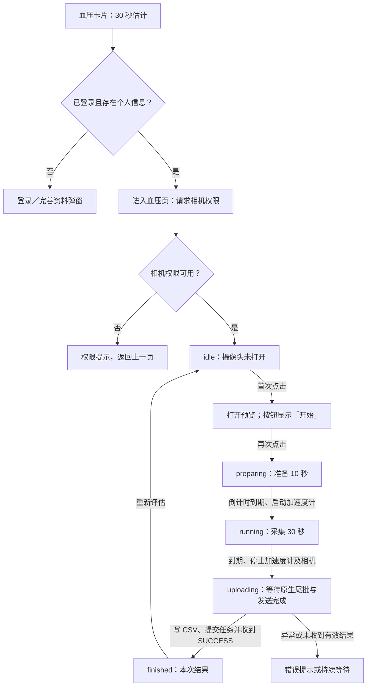
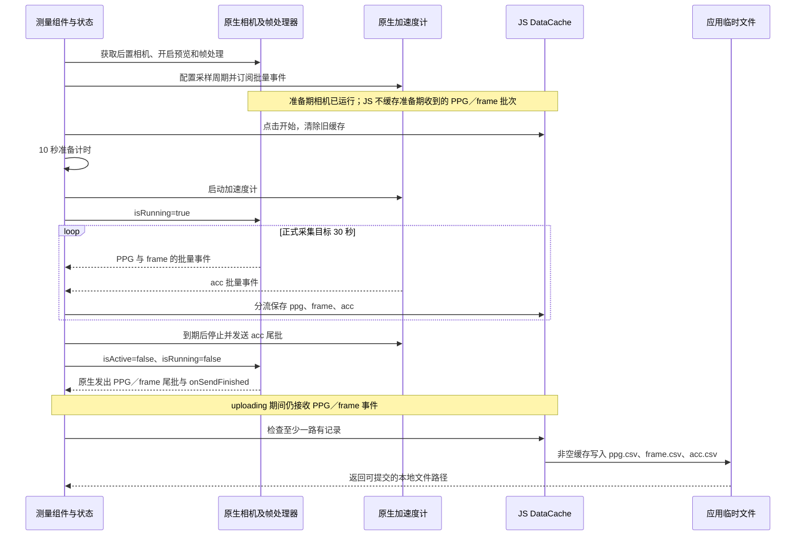
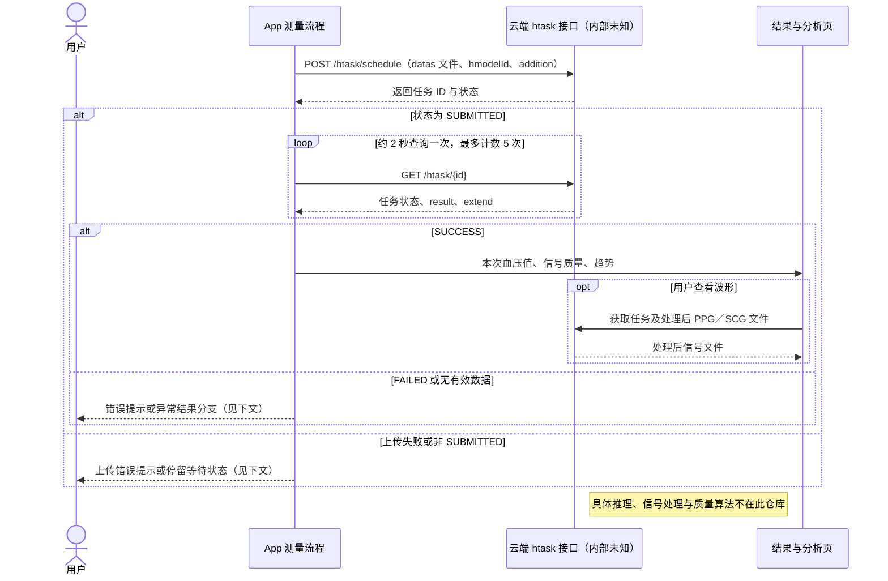

# 参考项目 `nxhe-app-intl` 的血压估计流程

## 文档边界

本文记录参考项目 `nxhe-app-intl` 当前源码中的血压（`bp`）采集、提交和结果展示流程，供 `health-cv-app` 后续设计时核对。文中路径和行号均相对于 `nxhe-app-intl/`；“已实现”仅指参考项目的代码行为，**不是 `health-cv-app` 已实现的功能或已确定的参数、接口与模型协议**。新项目的目标边界见 [代码组织与模块边界](./code-organization.md) 和 [技术选型与实施边界](./technology-stack.md)。

此流程使用手机后置摄像头和手机内置加速度计，不连接蓝牙血压计；上传的是提取后的信号和摄像头元数据，不是原始视频。App 不在本地对传感器信号进行血压模型推理：服务端任务返回 `sbp`、`dbp` 后，App 做结果转换、质量判断、分级和展示。参考仓库没有服务端模型源码，因此**具体特征提取、SCG 生成方法、模型结构与推理耗时均不可由此确认**。

## 1. 用户路径与测量状态

血压卡片经 `VHealthCards` 检查登录和 `bioInfo` 是否存在；这不是逐字段的健康资料完整性校验。血压页展示指标介绍、四步操作、上次结果及质量分、仅供参考的滚动提示。组件挂载时就请求相机权限；首次点击仅打开摄像头，第二次点击才开始准备。权限失败会提示并退页。依据：`src/pages/chs/index.tsx:35-40`、`src/components/VHealthCards/index.tsx:24-48`、`src/packages/chs/bp/index.tsx:21-63`、`src/packages/components/VChsMeasureComp/index.tsx:54-100,113-121`。

四步引导依次为手指轻按后置主摄、确认预览红亮、点击开始并保持静止、将手机贴近胸口心脏位置保持静止；四步使用同一张示意图，轮播不随测量状态推进。预览打开时，设备有闪光灯则随 `isActive` 启用；进入 `uploading` 后摄像头不再 active。依据：`src/hooks/steps.ts:17-21`、`locales/zh_CN.json:523-528`、`src/packages/components/VChsMeasureComp/PPGCamera/index.tsx:114-160`。

`bp` 配置的 **10 秒准备 + 30 秒正式采集** 是定时目标，不包含打开摄像头、传感器启动／停止、生成文件、上传和云端处理的耗时。准备阶段按钮显示倒计时；正式阶段按钮为红色呼吸动画，也显示剩余秒数；上传与等待结果阶段只有转圈，没有单独的进度百分比。页面没有暂停、继续或取消测量按钮，退出页面才执行定时器与传感器清理。依据：`src/services/config.ts:167-180`、`src/packages/components/VChsMeasureComp/actions.ts:87-130,195-200`、`src/packages/components/VStatusButton/index.tsx:52-87,97-129`。

| 提示 | 触发条件与用户可见反馈 |
| --- | --- |
| 血压专用 `bp-30s` 音频 | `preparing` 且倒计时为 10 时调用播放，**不是正式采集开始时**；音频文件的实际台词和长度未实测。 |
| 倒计时语音 | 正式采集剩余 10 秒、3 秒时分别调用播放。 |
| 光线／手指遮挡 | 原生帧事件携带提示标记时显示 3 秒 toast；两类提示共用 5 秒节流，正式采集期间才尝试播放相应语音。提示本身不会阻止或延长采集。 |
| 权限、上传或结果异常 | 相机权限失败提示后返回；上传异常 toast 后回到 `idle`；通用错误弹窗确认后返回上一页。 |

依据：`src/packages/components/VChsMeasureComp/actions.ts:244-289,174-190`、`src/packages/components/VChsMeasureComp/PPGCamera/index.tsx:30-40,86-99`、`src/common/modal/index.ts:38-49`。正式采集期间再次点击测量按钮会被非 `idle` 守卫忽略，不是暂停操作；见 `src/packages/components/VChsMeasureComp/actions.ts:105-120`。

## 2. 原生采集、事件传输和文件生成

`SensorFactory` 订阅 `Accelerometer` 原生事件；传感器目标间隔为 5 ms，传给原生的是 5000 微秒。摄像头请求后置、720×720、30 fps、`blockSize=1`。这些是**请求参数**，不能据此宣称设备实采稳定达到 200 Hz、720×720 或 30 fps；自动曝光开启时也不能把配置中的 ISO 800／曝光延迟直接视为固定实测参数。依据：`src/services/config.ts:93-106,167-180`、`src/services/sensorFactory.ts:63-80`、`src/services/sensorManager.ts:10-39`、`src/packages/components/VChsMeasureComp/PPGCamera/index.tsx:70-81,114-136`。

| 数据源与文件 | 原生来源、发送方式 | CSV 列 |
| --- | --- | --- |
| PPG → `ppg.csv` | 后置相机的 YUV 图像均值；相机原生侧批量发送，JS 只在 `running`／`uploading` 收下。当前 `blockSize=1`，得到全画面的颜色均值而非血压值。 | `timestamp`, `timestampFrame`, `timestampSystem`, `avgY`, `avgU`, `avgV`, `frameIndex`, `blockIndex` |
| 摄像元数据 → `frame.csv` | 曝光、帧时长、ISO 等采集元数据，与 PPG 分别缓存；Android 来自 Camera2 capture 回调，iOS 来自视频 sampleBuffer 回调时的设备属性。 | `timestamp`, `timestampFrame`, `timestampSystem`, `exposureTime`, `durationTime`, `rollingShutterSkewTime`, `iso`, `whiteBalanceMode` |
| 加速度 → `acc.csv` | 手机内置加速度计；原生累计至 1000 条或距上次发送约 5 秒时触发批量发送，初次批次可能较早发送，停止时发送尾批。 | `timestamp`, `timestampEvent`, `timestampSystem`, `accX`, `accY`, `accZ` |

列定义见 `src/services/config.ts:14-45`；JS 字段处理见 `src/services/entities.ts:101-112,153-174`。Android 图像处理与批量传输见 `android/app/src/main/java/com/nxhe/app/ppgcamera/FrameProcessor.kt:29-48,78-207`、`android/app/src/main/java/com/nxhe/app/utils/DataHub.kt:16-68`；iOS 对应见 `ios/nxheapp/NativeModules/cpp/FrameProcessor.cpp:13-109`、`ios/nxheapp/NativeModules/cpp/DataHub.h:44-101`。加速度批量规则见 `android/app/src/main/java/com/nxhe/app/sensors/BaseSensor.kt:24-28,72-105`、`ios/nxheapp/NativeModules/Sensors/BaseSensor.m:56-87`。

JS 中每路 `DataCache` 用内存数组累计，结束后一次性拼成 CSV，再写入 `${RNFS.TemporaryDirectoryPath}/ppg.csv`、`frame.csv`、`acc.csv` 中的非空文件；**没有逐采样落盘、时间对齐、排序或三路完整性检查**。文件名固定，不是每次测量独立命名。正常上传结束也没有立即清理临时文件；清理依赖后续缓存清除／页面卸载，且清理调用未等待完成。依据：`src/services/dataCache.ts:13-49,80-118`、`src/services/fileManager.ts:21-35`、`src/packages/components/VChsMeasureComp/actions.ts:132-146,195-200`。

### 平台语义与采集边界

Android `ppg.timestampSystem`／`acc.timestampSystem` 来自 `System.nanoTime()`；iOS 对应字段来自 `NSDate` 的 Unix 时间，**同名字段不代表同一时钟**。Android 的 frame 曝光／帧时长来自逐次 Camera2 结果，iOS 的 `durationTime` 按请求帧率推算、`rollingShutterSkewTime` 固定为 0。JS 直接重命名加速度向量而不换算单位；跨平台统一量纲仍需用平台契约和实测数据确认。依据：`android/app/src/main/java/com/nxhe/app/ppgcamera/FrameProcessor.kt:78-85,182-207`、`android/app/src/main/java/com/nxhe/app/sensors/BaseSensor.kt:72-85`、`ios/nxheapp/NativeModules/PPGCamera/PPGCamera.mm:404-468`、`src/services/entities.ts:101-112`。

采集开始和结束依据 JS 状态与定时任务，事件按**收到整批时的状态**入缓存，没有按样本时间戳裁切。原生 `onSendFinished` 表示相机停止路径已触发批次 flush，但源码没有 JS 尾批处理完成的确认屏障。[INFERENCE] 准备期末尾样本可能随跨界批次进入正式采集窗口；停止边缘的在途事件可能使三路快照范围不完全一致。具体是否发生及程度须在设备上用时间戳验证。依据：`src/packages/components/VChsMeasureComp/actions.ts:87-147`、`src/packages/components/VChsMeasureComp/PPGCamera/index.tsx:86-112`、`android/app/src/main/java/com/nxhe/app/ppgcamera/PPGCamera.kt:261-272`。

## 3. 上传、云端任务与结果回显

`POST` 使用 `multipart/form-data`，每个非空 CSV 作为同名 `datas` 字段；`hmodelId=2`、`addition=DeviceInfo.toJSON()` 是表单字段。上传请求的默认超时 30 秒与采集的 30 秒是两个独立配置。当前 `nxhe-app-intl` 源码将 `prefix` 固定为 `ios_cn`，因此任务接口路径为 `ios-cn/api/htask/schedule`；请求头带 `X-Client-Key`，有 Cookie 时附加 Cookie。此处只陈述参考项目当前配置，**不作为新项目服务端协议**。依据：`src/api/common.ts:8-28`、`src/api/services/taskServices.ts:5-25`、`src/api/apiClient.ts:8-35,204-254`、`src/packages/components/VChsMeasureComp/actions.ts:174-190`。

仅返回 `SUBMITTED` 的任务才触发按 ID 查询。参考实现配置查询间隔 2000 ms、最多计数 5 次；首次查询不是额外等待 2 秒。`useHTaskPolling` 在没有有效响应、终态或计数达到上限时停止后续定时查询，故不能把“5 次”简化为固定 10 秒的处理超时。依据：`src/services/config.ts:150-157`、`src/hooks/htask.ts:87-140`、`src/packages/components/VChsMeasureComp/actions.ts:149-172`。

结果 DTO 包含 `sbp`、`dbp`、`qualityScore`、`qualityThreshold`、`qualityPassed`；处理后 PPG／SCG 的 URL 位于 `extend`。本次页显示数值、质量分及相对上次的升降趋势；通过质量判断可重测、查看波形或进入详细分析，未通过只保留重测。详细分析页按血压类型展示固定建议；波形页另行获取任务及服务端处理后的信号文件。血压分级（正常、正常高值、低血压及三级高血压）和颜色由客户端计算，**不是另一次客户端模型推理**。依据：`src/types/dto/result.ts:1-17,55-63`、`src/common/hresultMap/index.ts:53-101`、`src/packages/components/VChsMeasureComp/ChsNowResult/index.tsx:21-76,146-240`、`src/packages/chs/pages/analysis/index.tsx:80-105`、`src/packages/chs/pages/waveform/index.tsx:70-105`。

## 4. 异常路径与后续优化核对点

下表区分直接可见的源码行为与需要实机、接口或产品决策确认的影响；不是 `health-cv-app` 的改造需求清单。

| 优先关注 | 参考项目的现有行为 | 风险与需要确认的事项 |
| --- | --- | --- |
| 结果真实性 | `SBP < 100` 或缺失时以随机的约 130–140 代替；`DBP < 60` 或缺失时以随机的约 80–90 代替，然后才分级与展示。 | **源码确定会改写结果**，包括可能真实偏低的数值。同一任务的展示可能不稳定；应先确定缺值与低值的正确产品契约。`src/hooks/hresult.ts:82-87` |
| 失败与质量门禁 | `FAILED` 只有存在 `result.error` 且质量分为假值时弹错误；其他 `FAILED` 会落入 `finished`。质量分为 0 或缺失时结果页默认视为通过，未直接使用 `qualityPassed`。 | [INFERENCE] 失败／缺字段记录可能显示为可查看的结果；需要按服务端协议定义成功、质量不通过和任务失败。`src/packages/components/VChsMeasureComp/actions.ts:156-171`、`src/packages/components/VChsMeasureComp/ChsNowResult/index.tsx:205-240` |
| 无响应与恢复 | 上传返回非 `SUBMITTED` 不启动轮询；没有 `onSendFinished` 超时；查询无有效数据会停止自动轮询。CSV 写入错误不在上传的 `try/catch` 内。 | [INFERENCE] 可能停在转圈或没有恢复入口；需明确各阶段超时、错误反馈和可重试条件。`src/packages/components/VChsMeasureComp/actions.ts:132-193`、`src/hooks/htask.ts:114-137` |
| 初始化与采集完整性 | 挂载和打开相机时各调用一次初始化；未等待异步传感器初始化就设置 `idle`；传感器启动／停止错误主要被记录日志；上传前仅验证至少一路有数据。 | [INFERENCE] 就绪竞态、旧监听残留或缺少必需信号未必能及时发现；需用实机事件与三路样本数核实。`src/packages/components/VChsMeasureComp/index.tsx:56-79,98-100`、`src/services/sensorManager.ts:18-68`、`src/packages/components/VChsMeasureComp/actions.ts:132-146` |
| 样本与文件边界 | 按到达状态缓存整批、固定临时文件名、清理异步且正常提交后不立即回收。 | [INFERENCE] 跨阶段混入、重复测量文件覆盖／清理交叠需要验证；先明确会话 ID、时间单位与文件生命周期。`src/packages/components/VChsMeasureComp/PPGCamera/index.tsx:86-112`、`src/services/fileManager.ts:21-31`、`src/services/dataCache.ts:31-36,80-118` |
| 用户预期 | “30 秒估计”不包含准备与网络等待；先点“摄像头”再点“开始”；遮挡提示不暂停采集；测量期间无取消键。 | 核对用户在各阶段应做的动作及失败后的恢复方式，避免把采集完成误作推理完成。`src/services/config.ts:167-180`、`src/packages/components/VChsMeasureComp/index.tsx:81-100`、`src/packages/components/VChsMeasureComp/PPGCamera/index.tsx:86-99` |

已通过参考项目源码核对上述调用链；**未运行参考 App、真实传感器采集或线上请求**，不宣称实际 fps／Hz、提示音内容、服务端模型行为或错误发生频率。原生事件顺序、平台单位、临时文件回收和后台中断行为仍需设备与接口实测。对 `health-cv-app` 的具体状态转换、文件协议和云端接口，须依据新项目决策独立确定，不能直接复制这些参考实现参数。
