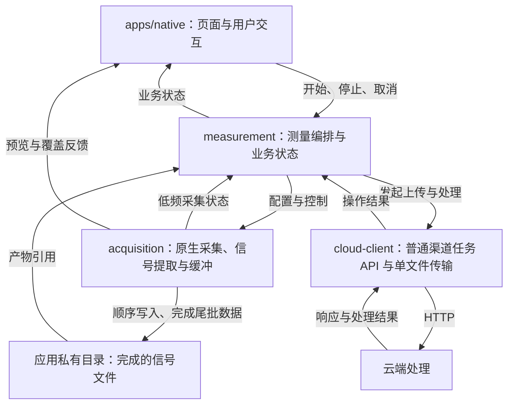

# 技术选型与实施边界

## 1. 文档范围与决策状态

本文整理 health-cv-app 当前讨论形成的技术栈、运行时数据路径和实施边界。目录与模块职责见 [代码组织与模块边界](./code-organization.md)。本文是技术选型状态的维护入口，代码组织文档不重复维护完整选型表。

本项目是 React Native 手机 App，通过相机和运动传感器采集信号序列，保存为文件后上传云端处理。CV 指心血管（cardiovascular），不是计算机视觉。本文不讨论健康指标算法或测量有效性。

决策状态分为：

- **已明确**：用户已经明确选择的技术或约束。
- **待定**：需要后续数据协议、产品要求或兼容验证才能确定的内容。

本文区分目标选型与已实施能力；版本以锁文件和 Android 构建记录为准，未标为已实施的方向不代表已有运行代码。

## 2. 技术栈总表

| 领域         | 技术选型                                       | 状态  | 用途与边界                               |
| ---------- | ------------------------------------------ | --- | ----------------------------------- |
| 应用框架       | React Native + TypeScript                  | 已明确 | Native 应用与业务代码                      |
| 工程管理       | pnpm workspace                             | 已明确 | 应用位于 `apps/native`                  |
| 功能包        | `measurement`、`acquisition`、`cloud-client` | 已明确 | 按功能边界组织，不独立拆 `state/data/contracts` |
| 开发构建       | Expo development build，本地构建优先              | 已明确 | 支持自定义原生模块，不使用 Expo Go 承载采集实现        |
| 宿主工程管理     | Expo Prebuild / CNG                        | 已明确 | 配置与插件管理宿主定制，采集源码保留在功能包              |
| 页面导航       | React Navigation                           | 已明确 | 应用端页面与路由                            |
| 原生绑定       | Nitro Modules                              | 已明确 | 自研采集接口与原生回调                         |
| Android 相机采集 | Kotlin + CameraX | 已实现，已在模拟器验证 | 主动后摄 PPG 与独立前摄被动录像；实体机兼容与长时间后台运行待验证 |
| Android 运动传感器采集 | Kotlin `SensorManager` + Nitro Modules | 已实施，Pixel_5 AVD 实测 | 四种默认传感器独立控制并写入 CSV；实体设备兼容与性能仍待验证 |
| iOS 采集 | Swift + AVFoundation + Core Motion | 已选路线，未实施 | 本变更不含 iOS 原生代码 |
| 连续文件写入 | Android 原生文件 API；iOS Foundation FileHandle（待实施） | Android PPG、被动视频与传感器 CSV 已实施 / iOS 待实施 | PPG 双 CSV、传感器单源 CSV 与独立私有视频；JavaScript 不拼接样本或媒体 |
| JS 文件管理    | `react-native-file-access`                 | 已明确 | 目录、查询、移动与清理等低频操作                    |
| 状态管理       | `nanostores` + `@nanostores/react`         | 已明确 | 业务状态与应用状态，React 绑定只用于应用端            |
| 国际化        | `@nanostores/i18n`                         | 已明确 | 界面文案、语言切换与格式化                       |
| 偏好持久化      | `@nanostores/persistent`                   | 已明确 | 语言、主题等小型配置                          |
| 偏好存储底层     | `react-native-mmkv`                        | 已明确 | 适配 `persistent` 的同步存储接口             |
| 令牌安全存储 | `expo-secure-store` | 已明确 | 应用端安全保存按服务地址与渠道隔离的认证凭据 |
| 服务端数据管理    | `@tanstack/react-query`                    | 已明确 | 查询缓存与离散请求生命周期                       |
| HTTP 通信    | Axios                                      | 已明确 | JSON 请求、结构化错误、取消及单文件上传/下载          |
| 样式         | `styled-components/native`，稳定版 v6 路线       | 已明确 | 沿用用户的样式偏好，不采用 v7 alpha 作为基础         |

选择 Nitro 不要求放弃 Expo，也不要求使用 VisionCamera。原生绑定、应用工具链和相机实现分别决策；当前相机路线已经确定为自建模块，VisionCamera 不再作为本阶段候选。

## 3. 主动 PPG 与云端目标链路

完整产品目标仍是信号文件保存后多文件上传云端处理；本变更实现 Android 后置相机 PPG 到私有 CSV，以及独立的前摄被动录像到私有视频文件，不实现自动上传或云端处理。
下图仅表示主动 PPG 与测量／云端目标链路；被动录像由用户显式启停并由 Android 前台服务管理，JavaScript 只接收低频控制结果、状态和视频引用，详细边界见第 4.1 节。

图中表达操作和数据路径，不代表包之间可以反向导入。具体依赖方向遵守代码组织文档。

本次 JavaScript 只接收控制结果、低频设备状态、经验提示、结构化错误和完成产物引用，不接收像素、样本或 PPG 记录批次，也不承担完整样本的长期累积和最终文件序列化。

采集完成、上传完成和云端处理完成分别推进业务状态，不能将任意一个提前视为最终测量成功。

## 4. 原生采集、缓冲与实时反馈

### 4.1 自建采集模块

Android 采集包以 Kotlin 和 CameraX 实现主动后摄 PPG 与被动前摄录像；另以 `SensorManager`、独立控制器和 Nitro 低频接口采集加速度计、陀螺仪、磁力计与重力传感器。iOS 的 Swift、AVFoundation、Core Motion 仍是已选路线，尚未实施。

PPG 候选请求为 720×720、30 FPS，由 CameraX 协商并报告实际尺寸与帧率；被动视频报告媒体文件的实际尺寸和时长。四种运动传感器已在 Android AVD 验证真实 `SensorManager` 回调和 CSV；实体设备兼容、持续性能与生产基线仍未验证。跨相机／传感器时钟对齐和信号质量也未确定。

主动 PPG Nitro 接口只暴露控制命令、低频状态／提示与双文件引用；被动 Nitro 接口只暴露配置、启停、低频状态／原因及私有视频引用；传感器 Nitro 接口只暴露逐类型能力、控制、低频状态和 CSV 引用。三条路径都不向 JavaScript 传递像素、媒体字节、样本或批次。

被动录像不复用主动 PPG 的像素与 `DataHub` 路径；当前没有被动像素分析、人脸检测或基于画面筛选。主动 PPG 页面由用户操作控制，不因新增前台服务而变为后台采集。

Nitrogen 生成的绑定代码属于采集模块的构建产物，需要随模块按其构建要求管理；这不等同于建立手写公共 C++ 处理层，不为使用 Nitro 提前迁移全部处理逻辑到 C++。

### 4.2 信号与覆盖反馈分开输出

本次每个正式采集帧在原生侧生成一条 PPG 记录，并与 Camera2 实际结果按传感器时间戳精确配对；同一有序消费者同步写入两份 CSV。预览期间最多暂存 64 条含传感器时间戳的数值结果，在会话启动时用于关联流水线中仍在途的图像。

手指覆盖检测是客户端实时反馈，不依赖云端处理方式。它在原生侧产生指标，独立通知 JS，不等待信号批次填满或文件完成。可以复用帧处理中的像素读取与区域统计，但不能在必要空间信息已经丢失后假定仍可计算覆盖程度。

覆盖评分、是否达标和真实面积比例是不同语义。算法、阈值和展示含义需真机验证后确定，不能直接将未经验证的评分标为面积百分比。

覆盖通知可采用状态变化或最新值合并，避免历史提示排队；信号序列则保留原始顺序和采集时间。预览降采样不能改变最终保存的信号数据。

### 4.3 缓冲所有权与延迟

采用有界缓冲。容量按当前待处理数据计算，不使用累计采集计数代替缓冲占用。

每批数据在原生侧保留会话、顺序和采集时间语义；本次 PPG 记录与 DataHub 批次不通过 Nitro 传给 JavaScript。消费者完成前不得复用或覆盖在途批次存储。

本次每个 PPG 会话独立创建有界 DataHub，默认容量 256 条、最大批次 50 条、消费间隔 1000 ms；容量包含排队及正在消费的记录。正常停止排空尾批，错误终止不返回成功产物。

分别验证帧处理、覆盖提示、批次写入和资源释放的行为；实际延迟、持续帧率及设备性能仍需实机验证，不能由小方法基准推断。

## 5. 文件管理与多文件上传

### 5.1 连续写入与低频管理

连续写入使用平台原生文件 API。PPG 的 `CsvBatchWriter` 通过 `PPGCsvEncoder` 与 `FrameCsvEncoder` 编码配对 CSV；传感器 `SensorSessionOutput` 使用 `SensorCsvEncoder` 保留逐类型六列表头并单独写入每种会话 CSV。iOS 写入器尚未实施。

正常停止必须等待 PPG 在途帧和 DataHub 尾批及两个文件关闭后才交付双文件产物；传感器停止等待注销、回调退出、尾批写入和单文件关闭后才交付产物。JavaScript 文件库不进入采样热路径。

`react-native-file-access` 是低频文件管理的已选依赖；PPG、传感器和被动视频文件由原生模块创建并通过完成产物引用提供，页面不直接读写会话文件。

### 5.2 保存位置与生命周期

主动 PPG、传感器 CSV 与被动视频分别写入应用私有持久目录中的独立会话路径。PPG 与传感器 CSV 以 `.part` 写入，满足正常收尾条件后才发布完成产物；被动视频需正常 Finalize 并通过媒体可读检查后才发布。未完成片段不作为成功产物返回。

释放摄像头、传感器和队列不删除采集产物。正在写入或上传的文件不得被清理。上传成功、云端处理成功与允许删除的关系，按保留策略明确，不隐式等同。

主动 PPG CSV、Camera2 `frame.csv` 和传感器 CSV 的表头及时间语义已确定；传感器协议、单调时间和重启后查询范围见 [Android 传感器采集](../acquisition/android-sensors.md)。产物保留期限与进程异常后的清理策略仍待定，不能把偏好持久化当作测量恢复能力。

### 5.3 Axios 单文件上传与下载

`cloud-client` 使用 Axios 上传单个文件引用，`POST /{channel}/tasks/{task_id}/files` 同时发送 `logicalName` 与 `file`。一个任务的多个输入由调用方逐文件调用；通信层不先把完整文件读成字符串或 Base64。

`baseUrl` 是不含 `/api/v1` 的 HTTP(S) 服务根地址；客户端追加一次 `/api/v1/{channel}`。React Native `FormData` 保留文件 URI 并由运行时生成 multipart boundary；不手写 `Content-Type`，也不改用文件库的网络功能。

输入和输出下载使用鉴权请求，返回 Blob 与可取得的媒体类型、附件头，不自动创建本地文件。Axios 取消信号到达实际请求；取消、超时或上传进度到达 100% 都不代表服务端操作已撤销或成功。

## 6. 状态、服务端数据与界面

### 6.1 Nano Stores 的所有权

`measurement` 依赖 `nanostores` 核心，以 Store 作为权威业务状态，由 `MeasurementSession` 推进流程。对页面只提供读取与订阅，通过命令操作，不保留内部状态与同步 Store 两套副本。

派生状态使用 `computed`，不重复保存。高频样本、完整信号批次、缓冲池和原生对象不进入业务 Store。实时覆盖反馈可以形成低频展示状态，但不逐帧触发整个页面更新。

`@nanostores/react` 仅用于应用端，取代自建 React 状态订阅包装。业务核心不依赖 React Hook，也不因持有采集接口而加载设备运行时。

认证状态 Store 只暴露恢复中、未登录、已确认身份和暂不可确认等必要事实；不复制令牌对、密码、完整账号或资料。令牌对以单条记录保存在 `expo-secure-store`，按规范化服务地址和普通渠道隔离；凭据读取或身份确认暂不可用时不会伪装为未登录。

### 6.2 React Query 与 Axios 的边界

应用端使用 `@tanstack/react-query` 管理服务端查询缓存和离散请求生命周期；查询与变更只调用 `cloud-client` 资源方法。Axios 请求/响应拦截器处理固定服务/渠道作用域内的一次传输、外部 Access Token 附加、成功包装解包和结构化通信错误。

认证敏感调用不进入通用 `MutationCache`。受保护查询由已确认认证状态门控，并按服务地址、渠道和会话代次隔离；退出或换账号时取消在途受保护调用并清理对应查询与变更缓存。通用查询与变更不自动重试、不持久化。令牌刷新和会话恢复由应用 auth 模块协调，不塞进 Axios 拦截器。

业务核心不依赖 React Query Hook 或 Axios；测量流程根据实际操作结果推进，不依赖页面是否仍挂载或某个界面回调是否执行。Query Cache 不保存完整信号序列。

React Native 的应用焦点和网络状态按实际需求接入 `focusManager`、`onlineManager`，不能照搬浏览器 `window` 行为。具体监听依赖尚未选定。

### 6.3 样式与实时界面

使用稳定版 v6 路线的 `styled-components/native`，具体补丁版本随兼容组合锁定。styled 组件在渲染函数外定义，动态样式用于离散或低频状态。

主题选择由应用 Store 管理，实际主题对象交给 `ThemeProvider`；颜色、间距、字号和圆角定义在应用主题目录，不再维护第二份主题选择状态。

Native 端不等同于浏览器 CSS，不能将 v7 alpha 的新能力当作 v6 已有能力。实时波形和连续动画不通过逐点改变 styled 属性实现；需要这些界面能力时，再单独选择绘图与动画方案。

## 7. 国际化与偏好持久化

`@nanostores/i18n` 用于应用端文案和格式化。语言优先级为用户明确选择、系统语言、应用回退语言。Native 接入系统语言来源，不使用浏览器检测示例替代它。首批支持语言和系统语言读取方案待定。

业务与原生模块返回错误码、状态和参数，界面负责翻译。不在业务 Store 中保存已经翻译的错误文案，避免切换语言后残留旧文案。

`@nanostores/persistent` 默认面向 `localStorage`，在 Native 中需要注册存储引擎；其同步接口不能直接用 AsyncStorage 的异步方法替换。使用同步键值存储 `react-native-mmkv` 适配该接口，具体兼容版本待锁定。

注册存储引擎后才创建持久化 Store。`react-native-mmkv` 只适配小型非敏感偏好；认证令牌对由 `expo-secure-store` 按规范化服务地址和渠道隔离保存，不写入 MMKV、Query Cache、MutationCache、日志或 URL。

## 8. 构建与版本组合

使用 Expo development build，优先本地 Xcode / Android Studio 构建。EAS 云构建不是必需项。自定义 Nitro 采集需要自己的原生构建，不能用 Expo Go 证明采集模块可运行。

使用 Prebuild / CNG，宿主定制通过应用配置与 config plugin 表达；当前手写采集源码仅位于 `packages/acquisition/android`，本次没有 `packages/acquisition/ios`。生成的宿主工程不作为采集源码的唯一保存位置，重新生成不能丢失必需定制。

Expo、React、React Native、Nitro、MMKV 和文件库需要作为整体兼容组合验证，不独立追逐最新版。Nitro／Nitrogen 0.37.1 与 CameraX 1.6.2 已锁定；整体兼容性、最低系统版本和生产设备基线仍需验证。

## 9. 流式处理预留与非目标

完整产品目标包含信号文件上传和云端处理；当前工程已有独立云端客户端与认证能力，但本变更没有实现测量上传流程或实时网络传输。

信号提取与文件写入保持职责分离，批次保留顺序和时间语义，云端协议留在 `cloud-client`。这些边界为后续流式消费者留出接入空间，不要求当前建立通用消费框架。

后续真正实施流式处理时，再确定传输协议、背压和结束语义。现在不建立占位 `StreamingClient`、空方法、伪实现、没有行为的开关或未使用的第二套原生绑定入口。

当前不加入 WeApp、独立中央 contracts 包、通用状态机、事件总线、降级框架和没有使用方的公共包。

## 10. 后续待定与验证

以下内容后续确定，不因文档中的目录或候选 API 而提前锁定：

- 主动 PPG 参数以外的采集参数、实体设备传感器基线、跨相机／传感器时钟映射及其它数据流的同步方式仍待确定。
- PPG 以外的信号格式、其它数据流的缓冲和背压需求。
- 经验覆盖提示在真机上的准确性、生产设备兼容和性能基线。
- 生产 API 地址、首发普通渠道与联调账号由部署及产品方提供；运行时配置必须显式注入，不从语言或时区推断。
- 产物保留与删除条件、网络和应用中断时的业务行为。
- 支持语言、系统语言来源、导航细节和界面绘图需求。
- 整体依赖版本与兼容组合、最低系统版本和设备能力基线。

本次验证覆盖 Android AVD 中主动 PPG、被动录像和四种真实 `SensorManager` 回调写入 CSV，并实测传感器并行、后台中断、进程重启及相机互斥。实体手机上的传感器兼容、后台限制、耗电和持续性能仍待实测；AVD 虚拟输入不代表真实人体 PPG 或实体运动数据。

依赖安装、构建及真实设备接入的验证状态以 `docs/development` 中的记录为准；本文的性能与生命周期要求是实施约束，不代表已完成验证。

## 11. 主要参考

- [Nitrogen 接口生成](https://nitro.margelo.com/docs/concepts/nitrogen)、[Nitro 回调](https://nitro.margelo.com/docs/types/callbacks)、[ArrayBuffer 所有权与线程](https://nitro.margelo.com/docs/types/array-buffers)。
- [Nano Stores](https://github.com/nanostores/nanostores)、[国际化](https://github.com/nanostores/i18n)、[持久化引擎](https://github.com/nanostores/persistent#persistent-engines)。
- [MMKV](https://github.com/margelo/react-native-mmkv)、[react-native-file-access](https://github.com/alpha0010/react-native-file-access)。
- [React Query 的 Native 接入](https://tanstack.com/query/latest/docs/framework/react/react-native)、[Axios multipart](https://axios-http.com/docs/multipart)。
- [styled-components Native](https://styled-components.com/docs/basics#react-native)、[v7 状态](https://styled-components.com/docs/v7)。
- [Expo development build](https://docs.expo.dev/develop/development-builds/introduction/)、[CNG 与宿主工程管理](https://docs.expo.dev/workflow/continuous-native-generation/)。

参考文档会变化。具体版本的支持范围以实施时锁定的兼容组合和真实运行结果为准。
