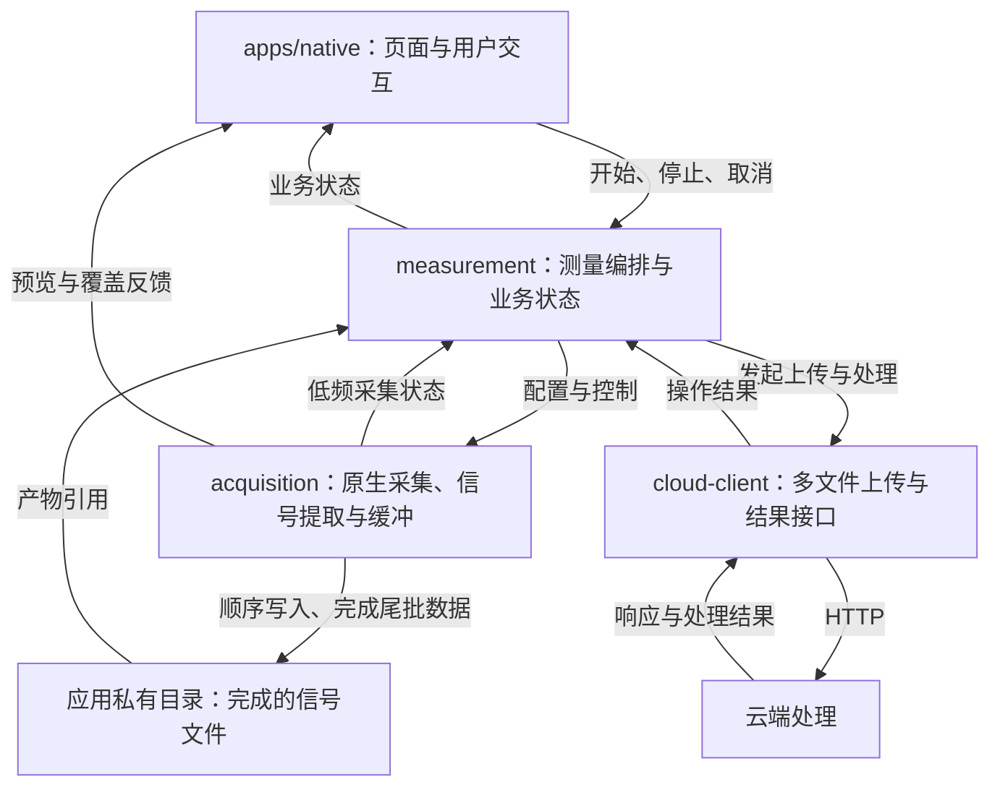

# 技术选型与实施边界

## 1. 文档范围与决策状态

本文整理 health-cv-app 当前讨论形成的技术栈、运行时数据路径和实施边界。目录与模块职责见 [代码组织与模块边界](./code-organization.md)。本文是技术选型状态的维护入口，代码组织文档不重复维护完整选型表。

本项目是 React Native 手机 App，通过相机和运动传感器采集信号序列，保存为文件后上传云端处理。CV 指心血管（cardiovascular），不是计算机视觉。本文不讨论健康指标算法或测量有效性。

决策状态分为：

- **已明确**：用户已经明确选择的技术或约束。
- **待定**：需要后续数据协议、产品要求或兼容验证才能确定的内容。

本文描述目标方案，不代表依赖已经安装、模块已经实现或真机验证已经通过。具体版本尚未锁定，不能用参考项目或官网示例中的版本替代本项目的兼容组合。

## 2. 技术栈总表

| 领域         | 技术选型                                       | 状态  | 用途与边界                               |
| ---------- | ------------------------------------------ | --- | ----------------------------------- |
| 应用框架       | React Native + TypeScript                  | 已明确 | Native 应用与业务代码                      |
| 工程管理       | pnpm workspace                             | 已明确 | 应用位于 `apps/native`                  |
| 功能包        | `measurement`、`acquisition`、`cloud-client` | 已明确 | 按功能边界组织，不独立拆 `state/data/contracts` |
| 开发构建       | Expo development build，本地构建优先              | 已明确 | 支持自定义原生模块，不使用 Expo Go 承载采集实现        |
| 宿主工程管理     | Expo Prebuild / CNG                        | 已明确 | 配置与插件管理宿主定制，采集源码保留在功能包              |
| 页面导航       | React Navigation                           | 已明确 | 应用端页面与路由                            |
| 原生绑定       | Nitro Modules                              | 已明确 | 自研采集接口与原生回调                         |
| Android 采集 | Kotlin + CameraX + SensorManager           | 已明确 | 自建相机与运动传感器模块                        |
| iOS 采集     | Swift + AVFoundation + Core Motion         | 已明确 | 自建相机与运动传感器模块                        |
| 连续文件写入     | Android / iOS 原生文件 API                     | 已明确 | 直接消费原生信号缓冲，不经 JS 拼接后落盘              |
| JS 文件管理    | `react-native-file-access`                 | 已明确 | 目录、查询、移动与清理等低频操作                    |
| 状态管理       | `nanostores` + `@nanostores/react`         | 已明确 | 业务状态与应用状态，React 绑定只用于应用端            |
| 国际化        | `@nanostores/i18n`                         | 已明确 | 界面文案、语言切换与格式化                       |
| 偏好持久化      | `@nanostores/persistent`                   | 已明确 | 语言、主题等小型配置                          |
| 偏好存储底层     | `react-native-mmkv`                        | 已明确 | 适配 `persistent` 的同步存储接口             |
| 服务端数据管理    | `@tanstack/react-query`                    | 已明确 | 查询缓存与离散请求生命周期                       |
| HTTP 通信    | Axios                                      | 已明确 | 请求执行、取消与多文件上传                       |
| 样式         | `styled-components/native`，稳定版 v6 路线       | 已明确 | 沿用用户的样式偏好，不采用 v7 alpha 作为基础         |

选择 Nitro 不要求放弃 Expo，也不要求使用 VisionCamera。原生绑定、应用工具链和相机实现分别决策；当前相机路线已经确定为自建模块，VisionCamera 不再作为本阶段候选。

## 3. 当前运行时主链路

当前范围是信号序列保存为文件后，多文件上传到云端处理。不实现边采集边网络传输，也不上传原始图像或视频。

图中表达操作和数据路径，不代表包之间可以反向导入。具体依赖方向遵守代码组织文档。

前后摄像头分阶段使用，不同时采集。JS 接收提取后的信号批次、低频状态和产物引用，不接收原样图像，也不承担完整样本的长期累积和最终文件序列化。

采集完成、上传完成和云端处理完成分别推进业务状态，不能将任意一个提前视为最终测量成功。

## 4. 原生采集、缓冲与实时反馈

### 4.1 自建采集模块

Android 使用 Kotlin、CameraX 和 SensorManager；iOS 使用 Swift、AVFoundation 和 Core Motion。主体实现归 `packages/acquisition`，宿主工程只负责模块接入及应用级配置。

具体帧率、分辨率、曝光、传感器种类和信号提取参数后续确定。不得为了沿用旧实现而继承含义不明的时间、采样率或质量字段。

Nitro 用于对外接口、原生对象或缓冲区传递及异步通知，不替代相机与传感器的处理队列。短方法同步返回的便利，不应被用于在主 JS 线程等待相机启动、整帧计算或文件 I/O。

Nitrogen 生成的绑定代码属于采集模块的构建产物，需要随模块按其构建要求管理；这不等同于建立手写公共 C++ 处理层，不为使用 Nitro 提前迁移全部处理逻辑到 C++。

### 4.2 信号与覆盖反馈分开输出

帧信号在原生侧逐帧或按多行平均后进入有界缓冲，具体分组和通道规则待定。

手指覆盖检测是客户端实时反馈，不依赖云端处理方式。它在原生侧产生指标，独立通知 JS，不等待信号批次填满或文件完成。可以复用帧处理中的像素读取与区域统计，但不能在必要空间信息已经丢失后假定仍可计算覆盖程度。

覆盖评分、是否达标和真实面积比例是不同语义。算法、阈值和展示含义需真机验证后确定，不能直接将未经验证的评分标为面积百分比。

覆盖通知可采用状态变化或最新值合并，避免历史提示排队；信号序列则保留原始顺序和采集时间。预览降采样不能改变最终保存的信号数据。

### 4.3 缓冲所有权与延迟

采用有界缓冲。容量按当前待处理数据计算，不使用累计采集计数代替缓冲占用。

每批数据需要明确会话、顺序和采集时间语义。交给 JS 的缓冲在消费完成前不得被原生线程覆盖；回调返回不等同于全部消费者已经释放。使用 Nitro `ArrayBuffer` 时需要明确所有权和访问规则，共享内存不自动获得线程安全。

停止时处理尾批数据，取消时按明确策略处置未完成数据，旧会话的迟到回调不得进入新会话。缓冲池容量、批次触发条件、回收协议和池满行为尚待确定，不能静默丢失测量信号。

分别验证方法调用、帧到信号、帧到覆盖提示、批次到 JS 的延迟。不能用同步小方法基准推断本项目的帧率或端到端响应；JS 调度、图像转换、队列积压与界面渲染都可能影响结果。

## 5. 文件管理与多文件上传

### 5.1 连续写入与低频管理

采集模块原生侧负责连续写入。Android 可使用 `FileOutputStream` / `FileChannel`，iOS 可使用 Foundation `FileHandle`，具体 API 随格式与实现确定。

停止后完成尾批写入并关闭文件，再交付可上传的产物。JS 文件库不进入逐帧热路径，不执行“原生样本转 JS 数组、拼接字符串或 Base64、再逐批追加文件”的保存流程。

JS 文件管理使用 `react-native-file-access`，只处理路径、目录、查询、移动和清理等低频操作。采集产物相关操作归 `acquisition`，删除时机由 `measurement` 的业务策略决定。页面不直接删除会话目录，不建立没有其他使用方的通用文件包。

### 5.2 保存位置与生命周期

待上传或仍需保留的信号文件放在应用私有持久目录，不默认依赖可能被系统清理的缓存目录。可丢弃、可重新生成的数据才适合放缓存目录。

释放摄像头、传感器和队列不删除采集产物。正在写入或上传的文件不得被清理。上传成功、云端处理成功与允许删除的关系，按保留策略明确，不隐式等同。

信号文件与偏好键值存储分开。文件格式、命名、保留期限、网络中断和应用退出后的处理方式仍待定，不能把偏好持久化当作测量恢复能力。

### 5.3 Axios 上传

`cloud-client` 使用 Axios 实现多文件 HTTP 上传。文件系统路径与上传 URI 分开处理，通信层接收文件引用和必要元数据，不先把整个文件读取成字符串或 Base64。

如果服务端采用 multipart，使用 React Native `FormData` 的文件引用契约，由运行时处理 multipart boundary，不手写不完整的 `Content-Type`。不能直接照搬 Expo `File` 与 `expo/fetch` 的示例，认定 Axios 具有相同契约。

多文件一次提交、分次提交、字段名、媒体类型和处理结束语义由真实服务器协议确定。Axios 的取消信号传递到实际请求；React Query 状态更新不能代替通信取消。

不同时使用文件库的网络功能或另一套上传客户端。后台上传、断点续传和自动重试不是当前默认范围，出现明确需求后再设计。

## 6. 状态、服务端数据与界面

### 6.1 Nano Stores 的所有权

`measurement` 依赖 `nanostores` 核心，以 Store 作为权威业务状态，由 `MeasurementSession` 推进流程。对页面只提供读取与订阅，通过命令操作，不保留内部状态与同步 Store 两套副本。

派生状态使用 `computed`，不重复保存。高频样本、完整信号批次、缓冲池和原生对象不进入业务 Store。实时覆盖反馈可以形成低频展示状态，但不逐帧触发整个页面更新。

`@nanostores/react` 仅用于应用端，取代自建 React 状态订阅包装。业务核心不依赖 React Hook，也不因持有采集接口而加载设备运行时。

### 6.2 React Query 与 Axios 的边界

应用端使用 `@tanstack/react-query` 管理服务端查询缓存和离散请求生命周期。`queryFn`、`mutationFn` 或必要的应用组装适配调用 `cloud-client`；Axios 负责真实请求、响应解析和通信错误。

业务核心不依赖 React Query Hook 或 Axios。测量状态转换由业务流程根据实际操作结果执行，不依赖页面是否仍挂载或某个界面回调是否执行。

不将 React Query 的完整请求状态镜像到 Nano Stores，也不让 Query Cache 保存完整信号序列。业务阶段与单次请求状态分别拥有明确负责人，不建立第二套测量流程。

React Native 的应用焦点和网络状态按实际需求接入 `focusManager`、`onlineManager`，不能照搬浏览器 `window` 行为。具体监听依赖尚未选定。

### 6.3 样式与实时界面

使用稳定版 v6 路线的 `styled-components/native`，具体补丁版本随兼容组合锁定。styled 组件在渲染函数外定义，动态样式用于离散或低频状态。

主题选择由应用 Store 管理，实际主题对象交给 `ThemeProvider`；颜色、间距、字号和圆角定义在应用主题目录，不再维护第二份主题选择状态。

Native 端不等同于浏览器 CSS，不能将 v7 alpha 的新能力当作 v6 已有能力。实时波形和连续动画不通过逐点改变 styled 属性实现；需要这些界面能力时，再单独选择绘图与动画方案。

## 7. 国际化与偏好持久化

`@nanostores/i18n` 用于应用端文案和格式化。语言优先级为用户明确选择、系统语言、应用回退语言。Native 接入系统语言来源，不使用浏览器检测示例替代它。首批支持语言和系统语言读取方案待定。

业务与原生模块返回错误码、状态和参数，界面负责翻译。不在业务 Store 中保存已经翻译的错误文案，避免切换语言后残留旧文案。

`@nanostores/persistent` 默认面向 `localStorage`，在 Native 中需要注册存储引擎；其同步接口不能直接用 AsyncStorage 的异步方法替换。使用同步键值存储 `react-native-mmkv` 适配该接口，具体兼容版本待锁定。

存储引擎注册完成后才创建持久化 Store，不能因为 ESM 顶层导入而在引擎就绪前初始化。只保存小型偏好，不保存高频样本或运行中的会话。若认证需要敏感凭据，另行确定安全存储，不默认放进普通偏好存储。

## 8. 构建与版本组合

使用 Expo development build，优先本地 Xcode / Android Studio 构建。EAS 云构建不是必需项。自定义 Nitro 采集需要自己的原生构建，不能用 Expo Go 证明采集模块可运行。

使用 Prebuild / CNG，宿主定制通过应用配置与 config plugin 表达；`packages/acquisition/android`、`ios` 保留手写源码。生成的宿主工程不作为采集源码的唯一保存位置，重新生成不能丢失必需定制。

Expo、React、React Native、Nitro、MMKV 和文件库需要作为整体兼容组合验证，不独立追逐最新版。workspace 避免重复的 React、React Native 和原生依赖版本。具体工具版本、最低系统版本和支持机型后续锁定。

## 9. 流式处理预留与非目标

当前只实现信号文件保存、多文件上传和云端结果处理，不实现实时网络传输。

信号提取与文件写入保持职责分离，批次保留顺序和时间语义，云端协议留在 `cloud-client`。这些边界为后续流式消费者留出接入空间，不要求当前建立通用消费框架。

后续真正实施流式处理时，再确定传输协议、背压和结束语义。现在不建立占位 `StreamingClient`、空方法、伪实现、没有行为的开关或未使用的第二套原生绑定入口。

当前不加入 WeApp、独立中央 contracts 包、通用状态机、事件总线、降级框架和没有使用方的公共包。

## 10. 后续待定与验证

以下内容后续确定，不因文档中的目录或候选 API 而提前锁定：

- 采集参数、颜色与空间语义、平均规则、数值精度及实际传感器数据类型。
- 时间基准、相机与运动传感器时钟映射、信号与元数据关联。
- 文件格式、数据布局、批次标识与上传元数据。
- 缓冲池容量、回收与背压规则，以及各环节延迟目标。
- 覆盖检测指标、阈值和展示含义。
- 云端接口、认证、请求组织、同步结果或异步任务方式。
- 产物保留与删除条件、网络和应用中断时的业务行为。
- 支持语言、系统语言来源、导航细节和界面绘图需求。
- 整体依赖版本与兼容组合、最低系统版本和设备能力基线。

实施后的验证必须覆盖真实采集、尾批写入、产物可读、多文件上传、取消和资源释放。实时路径关注持续运行的延迟、丢帧、积压、内存和发热，不能用空方法或模拟对象自证代替。

本次仅整理文档，尚未安装依赖、构建工程或运行真机采集与上传。本文的性能与生命周期要求是实施约束，不是已完成的验证结果。

## 11. 主要参考

- [Nitrogen 接口生成](https://nitro.margelo.com/docs/concepts/nitrogen)、[Nitro 回调](https://nitro.margelo.com/docs/types/callbacks)、[ArrayBuffer 所有权与线程](https://nitro.margelo.com/docs/types/array-buffers)。
- [Nano Stores](https://github.com/nanostores/nanostores)、[国际化](https://github.com/nanostores/i18n)、[持久化引擎](https://github.com/nanostores/persistent#persistent-engines)。
- [MMKV](https://github.com/margelo/react-native-mmkv)、[react-native-file-access](https://github.com/alpha0010/react-native-file-access)。
- [React Query 的 Native 接入](https://tanstack.com/query/latest/docs/framework/react/react-native)、[Axios multipart](https://axios-http.com/docs/multipart)。
- [styled-components Native](https://styled-components.com/docs/basics#react-native)、[v7 状态](https://styled-components.com/docs/v7)。
- [Expo development build](https://docs.expo.dev/develop/development-builds/introduction/)、[CNG 与宿主工程管理](https://docs.expo.dev/workflow/continuous-native-generation/)。

参考文档会变化。具体版本的支持范围以实施时锁定的兼容组合和真实运行结果为准。
