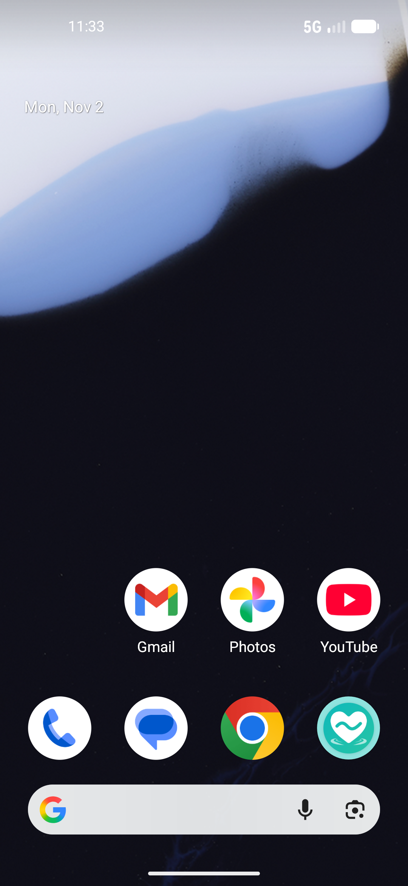
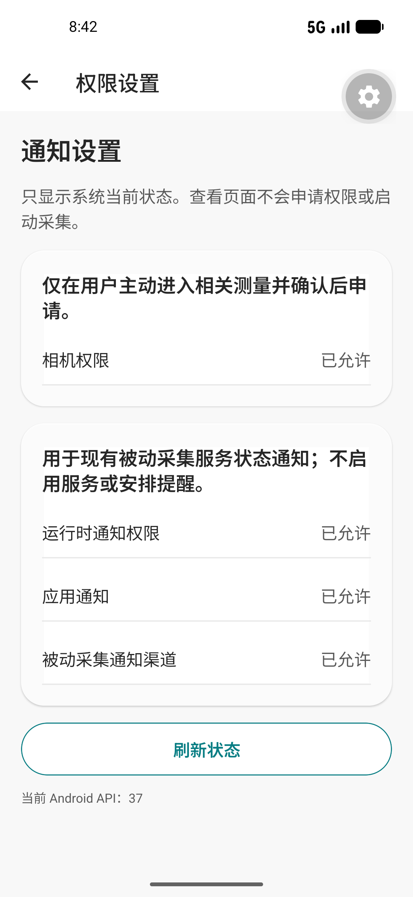
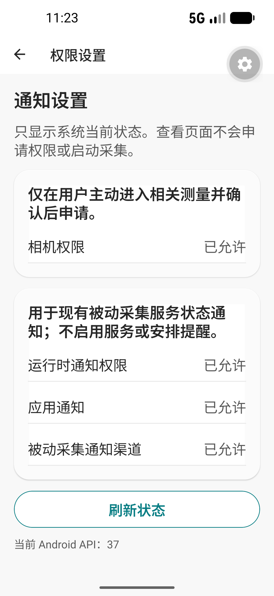
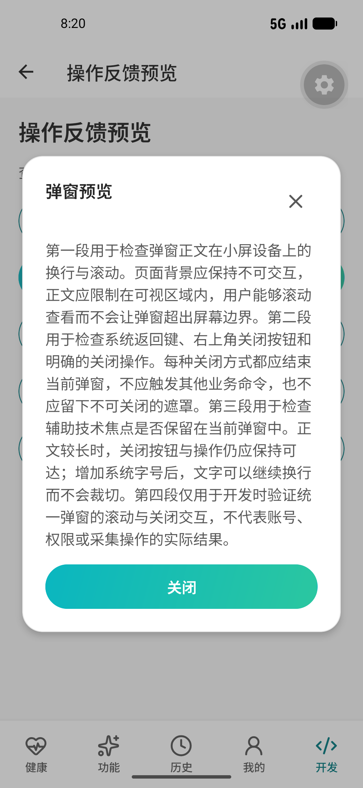
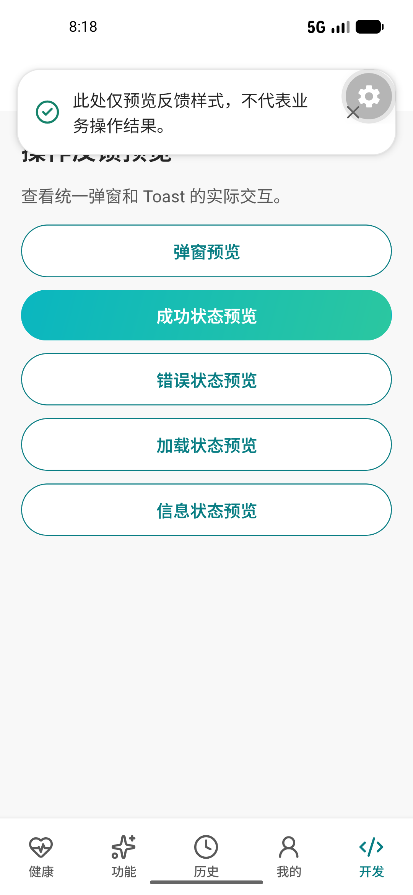
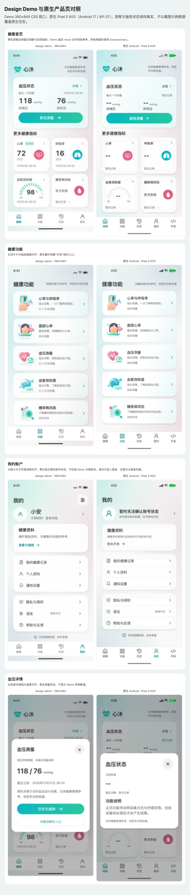
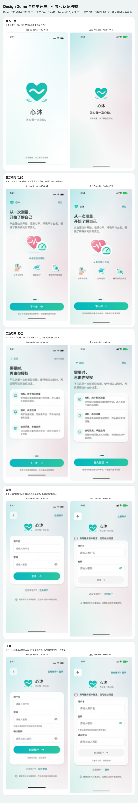

# 前端开发约定

## 1. 范围与实施状态

本文规定 `apps/native` 的 UI、数据流、缓存、国际化与组件开发方式。技术选型及实施边界见 [技术选型与实施边界](../architecture/technology-stack.md)，模块职责与依赖方向见 [代码组织与模块边界](../architecture/code-organization.md)。选型状态以技术选型文档为准，本文维护具体使用约定，不另建一套模块划分。

截至 2026-11-03，原生应用壳、五个产品 Tab、home/features/user 页面、开发入口、统一反馈、权限设置、品牌开屏与首次引导均已落地。当前产品界面固定使用简体中文；保留 `en-US` 资源和旧语言偏好不代表支持英文切换或英文验收。原生产品页已按 390×844 Demo 视口逐页复核；AVD 边界、Development Client 冷启动深链限制及键盘／读屏未覆盖项见 2.10，视觉对照见 2.11。

首版产品边界：

- 仅提供浅色主题，不提供深色主题、跟随系统主题或主题切换入口，也不预建未使用的主题偏好与持久化开关。
- 本版有效界面语言固定为 `zh-CN`；保留 `en-US` 资源、旧 `app.language-preference` 和通用解析工具，但它们不切换当前页面语言，不宣称英文界面通过验收。
- 实时波形是后续可能增加的能力，不纳入首版实现，不为其创建占位组件、空接口或第二套采样路径。历史波形回看与实时波形分别设计。

## 2. UI 与样式

### 2.1 样式组织

使用 `styled-components/native` v6 作为主要样式方案，不引入 SCSS、CSS Modules、Tailwind 或第二套通用样式体系。Native 样式不等同于浏览器 CSS，不迁移旧项目的全局 Sass 注入、BEM 工具或 Web 专用属性。

- 颜色、字号、行高、间距、圆角、背景配方和阴影在 `shared/theme` 中统一定义为类型化 token。颜色使用 `text.primary`、`surface.card`、`feedback.error` 等语义；业务评估使用独立的 `status`，不维护组件私有反馈色板。
- 首版由 `ThemeProvider` 提供浅色主题对象；系统切换深色模式不改变应用主题。集中 token 是为了保持视觉一致，不等于提前实现多主题切换。
- 跨模块引用优先使用 TypeScript 别名 `@/`（映射到 `apps/native/src`）；同一组件目录内的 `./styles` 等局部导入可保留相对路径。
- 原生 UI 组件按组件名建立目录，组件入口为 `index.tsx`；styled-components 定义放在同目录 `styles.ts`。纯应用壳等不包含组件样式时不创建空 `styles.ts`。
- styled 组件在渲染函数外定义；样式专用参数使用 `$variant` 等 transient props。动态样式只处理离散或低频状态，不逐帧重建 styled 属性。
- 相机预览、图表尺寸和动画等需要原生 style 接口时可直接使用，不为统一形式增加包装层；`StyleSheet` 不作为第二套主题和视觉规范来源。

#### 已确认的浅色主题令牌

以 `docs/design-demo` 产品页与截图为视觉基准。原生唯一来源是 `apps/native/src/shared/theme/theme.ts`，导航颜色映射在 `navigationTheme.ts`，根 `AppProviders` 固定提供浅色主题。Demo 通过 CSS 变量映射同一组 token；原生使用 SVG 与 React Native 组件渲染对应的背景、渐变卡片和插画，不迁移 Web DOM 或改变既定业务状态。


品牌、装饰、操作反馈与健康评估分开组织。主按钮正式采用已确认的青绿渐变与白字；深青用于文字操作和选中态。渐变白字不宣称满足 WCAG AA 文字对比度，不能将亮品牌色直接当作小字号文字颜色。

| Token | 值 | 用途 |
| --- | --- | --- |
| `brand.primary` | `#0AB6C0` | 品牌青、青色图形 |
| `brand.gradient` | `#0AB6C0 → #2BC7A0` | 品牌与主按钮渐变 |
| `brand.action` / `brand.pressed` | `#087D83` / `#075E62` | 文字操作、选中、按压 |
| `brand.subtle` | `#E5F7F6` | 浅青表面 |
| `accent.rose` | `#DD5D7D` | 当前心形、血滴和插画强调色 |
| `accent.roseMuted` / `accent.blue` | `#A64D63` / `#2E6F91` | 背景和辅助装饰 |
| `surface.canvas` / `surface.default` / `surface.subtle` | `#F8F8F8` / `#FFFFFF` / `#F0F0F0` | 画布、白色浮层、次级表面 |
| `surface.card` | `#FFFFFFED` | 半透明指标卡；透明度只施加在表面 |
| `border.default` | `#E6E6E6` | 中性边界与分隔线 |
| `text.primary` / `text.secondary` / `text.muted` | `#262626` / `#595959` / `#666666` | 正文、次要、辅助文字 |

`colors.illustration` 集中定义插画高光与轮廓色；例如镜头蓝 `#203F59`、头发紫 `#70546B` 是与 Demo 同源的深色细节，不是任意纯黑。功能插画根 SVG 使用 `fill="none"`，避免只定义描边的路径继承 SVG 默认黑色填充；首页呼吸率圆形使用 `brand.primary` `#0AB6C0`，不使用渐变薄荷端点。

装饰颜色不再按生理领域强制绑定。首页心率与风险图形使用亮玫红、呼吸率使用品牌青；插画可以混用青绿、玫红与蓝色。这些颜色不表示正常、异常或风险等级。

##### 操作反馈与健康评估

`colors.feedback` 为正式操作反馈语义。成功和错误色是本轮从品牌薄荷、亮玫红衍生的新值，不是旧色板别名；错误图标和输入错误边界可使用反馈错误色，标题和正文保持中性。

| 反馈 Token | 图标色 | 用途 |
| --- | --- | --- |
| `feedback.success` | `#16836B` | 操作已完成 |
| `feedback.error` | `#C54868` | 操作未完成、输入错误 |
| `feedback.loading` | `#087D83` | 正在处理 |
| `feedback.information` | `#2E6F91` | 信息说明 |

Toast 统一白底、中性边框、深色正文，主要用面性图标和状态文字区分。图标色与白色的计算对比度分别为 4.67、4.67、4.92、5.53；这只说明这些色对，不代表所有组件或渐变白字通过无障碍验收。普通反馈不借用以下健康评估状态：

| 评估 Token | 值 | 含义 |
| --- | --- | --- |
| `status.unknown` | `#666666` | 未评估、无数据 |
| `status.pending` | `#087D83` | 正在评估 |
| `status.inRange` | `#2E6B55` | 处于目标范围 |
| `status.attention` | `#8A5D0B` | 需要关注 |
| `status.outOfRange` | `#B33A43` | 超出范围或风险偏高 |
| `status.critical` | `#7D1F2B` | 严重状态 |

评估色仅展示服务端或明确规则已确认的结果，不从原始读数自行推断。指标数值默认使用中性文字。

##### 背景、表面与文字角色

`backgrounds.home`、`backgrounds.functions`、`backgrounds.account` 和 `backgrounds.auth` 使用 Demo 对应的柔和径向渐变配方。每层 `color` 包含透明度，`center` 按页面宽高归一化（可超出 0–1），`radius` 为椭圆半径，单位 dp；数组顺序从上到下合成，最后使用 `base`。Web 映射 CSS 径向渐变；原生 `GradientBackground` 以 `react-native-svg` 的 `RadialGradient` 与 `Ellipse` 按相同坐标、半径和 alpha 合成。

`gradients` 的 `angle` 遵循 CSS 角度（0 度向上，顺时针增加），`colors` 与范围 0–1 的 `locations` 一一对应：

| 配方 | 值 |
| --- | --- |
| `gradients.button` | 105°，品牌青 → 品牌薄荷，位置 0 / 1 |
| `gradients.healthCard` | 120°，`#FFFFFFF5 → #E5F7F6EB`，位置 0 / 1 |
| `gradients.functionCard` | 120°，白色 84% → 白色 76% → 浅青 76%，位置 0 / 0.6 / 1 |

`typography.roles` 使用系统字体，支持字号缩放；度量为字号／行高／字重：

| 角色 | 值 |
| --- | --- |
| `pageTitle` | 24 / 32 / 600 |
| `sectionTitle` | 18 / 24 / 600 |
| `body` | 16 / 24 / 400 |
| `label` | 14 / 20 / 500 |
| `caption` | 12 / 18 / 400 |
| `metric` | 32 / 40 / 600，重点数值使用等宽数字 |

基础字号、行高和字重刻度仍可用于局部排版。角色不强行覆盖紧凑标题、单位等特例。

| 类别 | 值与约束 |
| --- | --- |
| 通用间距 | 4 / 8 / 12 / 16 / 20 / 24 / 32 / 40 / 48 dp |
| `layout` | 页面横向 24，窄屏 16；指标卡内边距 16，紧凑 14；首页底部 20，窄屏 12；窄屏阈值 359 dp；首次引导内容缩进 36、主插画舞台高 152、权限行垂直内边距 18、说明间距 6 dp |
| `radius` | 小圆角 4，输入框 8，卡片／弹窗／Toast 22，胶囊 9999 dp |
| `surfaceElevation.raised` | Web：2px 4px 12px、正文色 6.5%；iOS：偏移 (0,4)、透明度 5.5%、shadowRadius 16；Android：elevation 8、shadowColor `#26262614` |
| `surfaceElevation.overlay` | Web：0 8px 28px、正文色 12%；iOS：同偏移、透明度及 shadowRadius 28；Android：elevation 4 |
| 动效 | 快速 120、常规 220、浮层 280、加载旋转 900 ms；遵循减少动态效果设置 |
| 图标 | 通用操作使用 Lucide 线性风格，默认 24、紧凑 20、线宽 2 dp；反馈和业务图形允许面性；原生触控目标至少 48 dp |

平台阴影是视觉映射，不保证各平台像素一致；组件不复制平台样式。

##### 控件角色与总览图维护

`roles.button.primary` 提供基础色和 `gradients.button`，共享 `ActionButton` 实际通过现有 `react-native-svg` 渲染渐变，胶囊形状不裁切多行文字；次要按钮沿用白底深青边界，禁用按钮使用中性表面。`roles.error` 的图标与输入边界映射 `feedback.error`，标题与说明保留正文色。`roles.feedback` 集中定义白色反馈表面、中性边界与正文色。共享 `AppCard` 使用 22 dp 圆角与轻阴影；`health`、`function` 变体绘制对应渐变，`contentPadding` 与 `contentGap` 显式控制内部间距，不依赖 `style` 覆盖 styled-components 声明。

总览图由实际原生主题导出，不手工维护另一套色值：

```sh
node docs/development/render-theme-tokens.mjs 4177
```

访问 `http://127.0.0.1:4177/`，等待页面 `body[data-ready=\"true\"]` 后，以 1440px 宽度进行全页 PNG 截图，覆盖 `docs/development/assets/health-theme-token-sheet.png`。生成源为同目录的 `health-theme-token-sheet.html`。服务仅监听本机、仅提供预览和主题数据；通过 Web 平台适配导出主题，不启动 React Native。完成后停止服务。


### 2.2 布局、文字与页面容器

使用 RN 逻辑尺寸、Flex 与 `gap`。窗口尺寸通过 `useWindowDimensions` 获取，组件容器尺寸通过 `onLayout` 获取；不沿用旧项目的全局 `px/vw/vh` 换算或模块加载时固定的窗口尺寸。

默认使用系统字体，允许系统字号缩放；正文和多语言按钮不得因固定高度被裁切。数字、单位和正文的排版职责明确，不为中英文强制指定同一套外部字体。

应用路由页统一使用共享 `PageContainer`：原生导航头负责顶部 inset，容器负责左右／底部安全区和可滚动内容；状态栏由根 `App` 设置，子页不重复声明。当前会增长的本地采集产物列表保留各自查询范围，每类最多渲染 20 条，超限文案明确文件不会因此删除或清理；其它长列表优先使用虚拟化列表，避免无界记录直接放入普通 `ScrollView`。

### 2.3 图标

通用操作图标采用 `lucide-react-native` 与 `react-native-svg`，显式导入所需图标，不再引入第二套通用图标库。组件统一默认尺寸、颜色和线宽；可交互图标由按钮负责按压与可访问性，装饰图标不重复朗读。

品牌与医疗业务图标保留为本地 SVG 组件。可参考或复用旧项目合适的图形，但先核实资源授权、整理语义名称和颜色接口。生成源、生成方式和生成产物应与业务包装分开管理；不运行时下载图标，不把 SVG Path 下标作为长期业务接口。

### 2.4 图表与波形

历史趋势与低频统计图采用 ECharts、`@wuba/react-native-echarts` 的 SVG 渲染器及 `react-native-svg`，不使用 WebView；只注册实际使用的图表类型与扩展。此方向不表示旧项目版本已兼容当前 RN／Expo，实施时需锁定并验证具体组合。

图表的职责是接收展示数据、主题与语言，维护 init、update、resize、dispose；查询、账号隔离和分页不放入图表组件。容器尺寸变化时更新布局，序列或坐标系切换时明确替换策略，不依赖隐式合并保留旧序列。原始数据保持数值，精度与本地化由格式化层处理；缺失数据保留缺失语义，不补成 0，不制造健康数值。医学阈值不由绘图库决定。

波形边界：

- 历史波形是已完成产物的回看。需要时先确定文件大小、视窗与展示点数限制；大文件通过专门的数据处理生成有限点数或包络数据，不默认完整读取并绘制任意大小的原始 CSV。
- 当前原生接口只提供低频状态、提示与完成产物引用，没有实时波形样本接口。不能把接入图表库描述为已经具备实时波形。
- 后续实现实时波形时，单独确定原生预览或有界降采样展示接口、时间语义、更新频率及渲染方案。完整采样、缓冲与文件写入继续由原生持有，展示抽稀不得改变最终保存的采样数据。
- 完整采样流不进入 Nano Stores、React state 或 Query Cache，也不通过持续全量 `setOption` 驱动实时图表。首版不因未来需求提前接入 Skia 或另一套绘图栈。

### 2.5 动画

页面转场优先使用 React Navigation native-stack。加载、呼吸、淡入淡出等简单动画使用 RN `Animated`；`transform`、`opacity` 使用 native driver，不把每帧值同步到 React 或全局 Store。

动画由业务状态与页面可见性驱动，状态结束或组件卸载时停止；中断后的回调不得覆盖新状态。尊重系统减少动态效果设置，不用动画完成回调推进测量成功或文件完成等业务事实。

只有出现真实的手势联动或复杂连续动画需求时才引入 Reanimated 4，并一起验证 RN、Expo 与 `react-native-worklets` 的兼容组合。不复制旧项目 Reanimated 3 配置，也不为简单旋转预装另一套动画依赖。

### 2.6 组件边界

先建立应用实际需要的页面容器、文本、按钮、输入项、卡片与状态反馈，不建设大而全的组件库，不直接迁移 Taro／NutUI 包装。

- 基础组件统一视觉、禁用态、加载态、焦点和可访问性；优先使用明确的语义变体与受控接口，不修改传入的 props 或样式对象。
- 按钮 `loading` 时默认阻止重复点击；业务命令仍须防止重复执行，不能只依赖按钮禁用。
- 通用组件接收 `label`、`message`、操作回调等展示属性，不知道血压、任务上传等业务概念，不硬编码业务翻译键。
- 业务组件放在对应 `features/<feature>/<ComponentName>`，共享组件放在 `shared/components/<ComponentName>`；每个目录以 `index.tsx` 作为组件入口，styled-components 放在同目录 `styles.ts`。实际发生跨功能复用后才提升到 shared/components。不增加无行为的薄包装 Hook。
- 页面负责组合与交互入口；Hook 负责订阅、展示映射和局部 UI 状态。组件不直接调用 Axios、不操作采集文件、不编排采集、上传与云端处理。

#### 统一弹窗与 Toast

`AppProviders` 只挂载一个 `FeedbackHost`；页面通过 `useFeedback()` 调用 `showModal`、`dismissModal`、`showToast` 与 `dismissToast`。弹窗和 Toast 各自只呈现一条：弹窗使用主题、隔离背景交互、支持关闭按钮与 Android 返回键；默认可点遮罩关闭，长正文可滚动，关闭操作使用调用方提供的无障碍名称。

Toast 位于顶部安全区内。成功、错误与信息态默认 3.5 秒后关闭；加载态不自动结束，操作完成后由调用方显式关闭。新 Toast 替换旧提示并重置唯一计时器，过期的旧回调不能关闭新提示；手动关闭只关闭提示，不代表取消实际业务操作。短时结果使用 Toast，字段校验、会话、权限和采集失败等需要用户处理的状态留在原表单或页面；未知错误只映射安全中文提示，不回显底层异常消息、令牌或堆栈。


### 2.7 主动 PPG 与导航验收记录（2026-10-30，Pixel_5 AVD）

- 根导航使用单一 native-stack 容器，路由标题随语言更新；冷启动与运行中被动深链落到唯一被动页面目标，不自动启用服务。入口保留返回路径。
- 主动 PPG 已在 AVD 实际完成相机查询、参数草稿、预览、开始、停止并关闭；完成产物中 `ppg.csv` 与 `frame.csv` 各含表头及 180 条记录。页面切换前先等待已有命令与原生关闭／文件收尾。
- 离页守卫回归覆盖并发离开合并、关闭失败不放行导航且可重试、会话代次变化隔离，以及卸载后丢弃迟到导航。关闭失败时保留主动页和结构化错误码，不自动打开其它相机会话。
- Pixel_5 AVD 使用英文、字号 `1.35`、分辨率 `900×1950` 检查长文案换行与纵向滚动；状态栏与导航栏可见，未观察到横向溢出。系统动画比例设为 `0` 时检查操作仍可完成。
- 配置表单在 AVD 中可调出 Gboard 数字键盘；当前模拟器启用硬件键盘，因此键盘以浮动窗显示并遮挡部分页面内容，标准停靠软键盘下的遮挡／resize 行为未验证。TalkBack 曾实际启用检查控件状态；语音朗读结果未独立听辨，入口完整无障碍名称复验见 2.9。
- 此验证入口不是终版产品导航；AVD 结果不证明真机后台录像可用，也不宣称主动相机支持后台持续采集。

### 2.8 被动录像、传感器与统一系统栏验收记录（2026-10-30，Pixel_5 AVD）

- 环境：`Pixel_5` AVD，Android 17／API 37／arm64（`emulator-5554`）。以下采集与界面证据均来自模拟器，不代表实体设备。
- 被动录像：显式启用并按页面流程处理相机、通知条件；服务等待时相机已释放，离页后服务继续，返回页面刷新真实状态，页面和被动深链均不会自动启用服务。一次真实模拟器解锁事件生成 `files/passive-capture/dd45feeb-1cf2-44f2-88eb-16fe56e8da1d/video.mp4`；使用 macOS `/usr/bin/avconvert` 转码到 640×480，命令退出码为 0 且完成整段处理。此为 AVD 解锁触发和媒体可读证据，不证明实体设备上的长周期后台行为。
- 设备差异：HONOR 实体设备仅验证“确认后台运行设置”提示须由用户点击启用后才出现；未据此推断真机长时间后台录像通过。
- 传感器：Goldfish AVD 的四种默认传感器均报告可用；以 20,000 μs 请求间隔分别采集并停止，导出的 CSV 行数包含一行表头：

| 类型 | 会话 ID | 样本数 | CSV 总行数（含表头） | 实际表头 |
| --- | --- | ---: | ---: | --- |
| 加速度计 | `96d75719-e8e4-481a-a215-45615fc2b374` | 5,338 | 5,339 | `timestamp,timestampEvent,timestampSystem,accX,accY,accZ` |
| 陀螺仪 | `ac64e86d-5d7e-431d-8a52-85e86912966a` | 5,191 | 5,192 | `timestamp,timestampEvent,timestampSystem,gyrX,gyrY,gyrZ` |
| 磁力计 | `fb396e73-9cc3-4080-901c-5e83979ea60d` | 902 | 903 | `timestamp,timestampEvent,timestampSystem,magX,magY,magZ` |
| 重力传感器 | `b88fe8ba-4c34-4a99-8672-ea403755fbfb` | 721 | 722 | `timestamp,timestampEvent,timestampSystem,graX,graY,graZ` |

- 传感器隔离：加速度计和陀螺仪可同时运行；停止加速度计后陀螺仪仍在采集。切到入口再返回，前台会话保持；应用退到后台后会话以 `APP_NOT_FOREGROUND` 失败，返回前台不会自动重启。CSV 与 Goldfish AVD 的模拟轴值相符；没有实体传感器设备的正向数据验证。
- 页面与文件范围：所有路由使用原生导航头和共享 `PageContainer`；AVD 截图中状态栏图标保持深色，页面可纵向滚动且系统导航区域未被内容覆盖。传感器页切出再进入后仍显示加速度计会话 `96d75719-e8e4-481a-a215-45615fc2b374` 的 CSV 引用；被动页重新进入后重新扫描应用私有目录，仍可访问已完成视频。主动 PPG 与传感器列表仅查询当前进程的完成引用，不扫描磁盘；被动视频列表扫描应用私有目录中的可读完成文件。三类列表上限为 20 条；本次 AVD 列表少于该上限，超限提示分支未在设备上触发。没有清理或恢复文件的行为。

- 页面滚动、系统安全区与完成产物访问已验证；大字号、键盘、安全区、读屏节点、减少动态效果和系统深色模式结果见 2.9。
- 错误文案：将应用语言从英文切到简体中文、再恢复英文后重进传感器页，原有 `APP_NOT_FOREGROUND` 会话和错误码保持不变，提示随语言变化；没有再次执行开始命令。该验证通过 Entry 返回语言设置，传感器页会卸载；“页面仍在导航栈时保留采样间隔草稿”未做单独的留栈操作，代码中 `periods` 与语言文案 Store 独立且没有语言变更重置逻辑。

### 2.9 前端基础设施跨模块集成验收记录（2026-10-30，Pixel_5 AVD）

- 构建与启动：已完成包含新增原生依赖的 Android development build，并在 Pixel_5 AVD（Android 17／API 37／arm64，`com.healthcvapp.mobile`）运行；无云端配置和正常配置两种模式下，三个本地入口及语言设置均可达。入口短文案修改经已安装 development build 的 Metro 热更新加载并复验，本次未重建原生 APK。Android 构建命令、依赖版本与设备信息见 [Android 开发与验证](./android-development.md)。
- 前台传感器路径：启动 Goldfish 加速度计后进入主动 PPG 并完成采集，再经站内入口返回传感器页单独停止；`dumpsys sensorservice` 显示 PPG 相机运行期间加速度计仍在采集，导航往返后会话持续。停止后页面与文件均显示会话 `ef8f6c27-a1e3-44cd-812b-30c0c1225bf6` 已完成；`accelerometer.csv` 有 3,719 条记录、3,720 行（含表头）、289,265 bytes，请求与注册间隔均为 20,000 μs。
- 相机深链路径：主动 PPG 相机运行时触发外部被动深链，CameraService 先记录 Camera ID 10 的 `DISCONNECT`，随后 `Active Camera Clients` 为空；被动页显示服务未启用／相机关闭，没有自动启动录像。重复深链没有叠加页面，主动相机离开守卫合并重复关闭请求；相机互斥仅约束相机持有者，传感器可与主动 PPG 并行。外部深链使宿主进入后台，传感器按既有契约以 `APP_NOT_FOREGROUND` 中断且不自动恢复；此中断会话不等同于前一条已完成 CSV。没有上传文件或声称云端处理成功。
- 界面与无障碍：在 900×1600、系统字号缩放 1.3 下实际查看中英文入口、主动 PPG、被动录像、传感器和语言设置；页面长文案可纵向滚动，系统状态栏与导航区可见。修复后中文入口显示“主动／被动／传感／语言”，UIAutomator 节点仍提供“主动 PPG／被动录像／传感器／语言设置”完整无障碍名称；英文入口保持完整显示名。节点树还核对语言单选状态、传感器开始／停止按钮可用状态及被动采集／相机动态状态。TalkBack 曾实际启用检查迁移页控件状态；入口短文案改动后另以 UIAutomator 节点树确认无障碍名称与显示文案分离。没有独立验收语音朗读内容。
- 系统与输入：系统深色模式开启时所有迁移页仍保持浅色；将系统动画比例设为 0 后实际完成入口与主动页往返。数值字段可显示 Gboard 数字键盘，但当前 AVD 以浮动键盘覆盖部分内容；正常停靠键盘下的页面避让行为未验证。
- 限制：传感器与相机均为 AVD 提供的 Goldfish／虚拟输入。本次结果不证明实体传感器兼容、长期后台采集、医学有效性或实体设备系统栏行为；常规停靠键盘及 TalkBack 语音输出仍未验收。

### 2.10 原生产品页与权限验收（2026-11-02–03，Pixel_5 AVD）

- 运行对象为 `com.healthcvapp.mobile` 原生应用，AVD 为 Android 17／API 37／arm64。桌面名称和品牌图标已在安装后的启动器检查；首页游客态无健康 mock，登录态 mock、已打开详情和登出后的隔离见[认证会话记录](./native-auth-session.md)。五项功能入口可达；历史、健康资料、个人资料、健康记录及帮助反馈均显示统一未开放说明，不出现资料编辑、历史查询、反馈输入或假提交。
- 页面分工：`home` 管首页、开屏、引导与指标详情；`features` 管五项功能说明；`history` 只显示未开放说明；`user` 管认证、权限与语言说明；`dev` 保留采集和开发验证入口。认证、查询、偏好、导航和采集生命周期仍归 `app`；主题、通用组件和反馈宿主归 `shared`。
- 独立 Release variant 的冷启动深链已在隔离 Android 用户上验收：首次引导未完成时发送 `healthcvapp://passive-capture`，Android 报告冷启动，静态开屏后到达“被动录像”，状态仍为“未启用”；Android 返回键回到“验证入口”。随后普通冷启动仍停在首次引导第 1 步，深链没有写入完成标记。运行中的重复暖启动深链也保持唯一页面、不自动启用服务。

- 开屏在 `SplashContent` 完成布局后才请求隐藏 Expo 原生层；品牌页完整复现 Demo 的双渐变、144 dp 标志、字标／Slogan 字号字距和底部说明。原生层以同底色及对齐主视觉位置的标志作短暂桥接；Android 使用 180 dp 图宽，标志落在 192 dp 系统安全圆内，退出时长设为 0，避免淡出叠影，不追加第二段等待。品牌页在原生层隐藏完成后累计前台可见的 2 秒，后台暂停。系统 Activity／JS 启动耗时不计入该时长。初始 URL 仍与时长并行读取，两者都就绪后才导航。`app.onboarding-completed` 是设备级 MMKV 标记，只在完成或跳过两步引导后写入；退出账号不清除，中断未完成流程不会置位。写入失败会明确提示但仍允许浏览，不保证下次跳过引导。前后台暂停与单次导航由 `startup-flow.test.cjs` 覆盖；本次 AVD 单次冷启动与后台恢复观测见 [Android 开发与验证](./android-development.md)。
- Expo Development Client 冷启动另有调试器限制：强停后传入自定义 URL 会先打开 Expo Development Build；连接 Metro 后初始 URL 丢失并回到产品页。运行中暖启动深链已在 Development Client 实操验证；独立 Release 的冷启动结果如上单独记录。
- 权限页在 Android API 37 实际验证相机拒绝、再次请求转系统设置、允许后回页刷新；通知授权单独显示系统请求，不连带申请相机或启动采集。系统应用通知总开关与被动通知渠道分别关闭／恢复后，回页状态刷新。图示仅记录界面状态，不含账号或测量数据。
- 系统字号缩放 1.3 且系统深色模式开启时，权限页保持浅色、各行可滚动查看；登录表单在大字号及键盘显示时用户名、密码和登录操作仍可达。原系统字号与主题设置已恢复。Toast 四态和单条替换、长内容弹窗、关闭及背景隔离均在模拟器操作。
- 主动 PPG 离开 Tab 时等待相机关闭与文件收尾；回到仍保留在导航栈的页面后，焦点刷新能显示已完成的两份 CSV。传感器切 Tab 后仍采集且可单独停止。被动服务通过明确确认后进入等待，离页／回页状态保持，取消或深链本身不启用服务。详细资源边界见[PPG](../acquisition/android-ppg.md)、[传感器](../acquisition/android-sensors.md)、[被动采集](../acquisition/android-passive-capture.md)。
- Goldfish AVD 的相机与传感器输入不代表人体或实体设备；没有据文件存在宣称健康测量成功、真实 PPG 有效、真机兼容或长期后台可用。标准停靠软键盘避让和 TalkBack 语音输出未验收。











### 2.11 design-demo 原生页面截图对照（2026-11-03，Pixel 5 AVD）

- 对照基准：`docs/design-demo`，浏览器视口 390×844 CSS px；原生为 Pixel 5 AVD，Android 17／API 37，截图来自最终 Release APK。对照图按实际屏幕比例缩放，覆盖静态开屏、两步引导、主页、功能、我的、登录注册与血压详情。
- 首页指标卡片保留 Demo 的 `#FFFFFFED` 表面填色，页面渐变仍从卡片外柔和透出；共享卡片阴影已减轻边缘感并增加扩散。主页详情与通用弹窗统一淡入；心率插画使用两道相隔半周期的波纹，系统启用减少动态效果时保持静态。
- “我的”账号摘要使用 Demo 同款用户名和辅助文案字号（24/32 dp、14/20 dp）；独立健康资料卡已移除，个人资料入口保留；页底登录／退出按钮宽内容区 90%、高 48 dp，分别使用品牌渐变和错误色至玫红渐变。
- 有意保留的业务差异：游客主页和指标详情不显示 Demo 固定 mock；云端未配置时登录／注册提交保持禁用且不额外显示错误提示；详情空态内容较短；首次引导只有已确认的两步；原生底栏额外保留“开发”入口。
- 可读性复验：Pixel 5 AVD 375×851 dp、系统字号缩放 2.0 时，账号辅助文案可换行；页面可纵向滚动至页底账户按钮，未见横向裁切。MainActivity 固定竖屏；测试后恢复了模拟器分辨率、字号、方向与动画设置。






## 3. 数据流与状态所有权

| 数据 | 权威来源 | 约束 |
| --- | --- | --- |
| 输入、弹窗、展开项、临时选择 | 组件局部状态 | 不因多个子组件使用就立即全局化 |
| 测量阶段、业务会话与命令 | `measurement` 内的 Nano Stores | 通过命令推进，对页面只读；不依赖 React 页面挂载 |
| 原生采集状态、提示与完成产物引用 | 原生客户端及低频应用适配 | 原生运行事实与测量业务阶段分开，不复制完整样本 |
| 账号资料、模型目录、任务与历史 | React Query | 不同步复制到 Nano Stores 或页面 state |
| 语言等设备偏好 | persistent 与 MMKV | 小型、非敏感；退出后保留；首版没有主题偏好 |
| Token | 现有 auth 与 SecureStore | 不进入普通 Store、Query／Mutation Cache、日志或 URL |
| CSV、视频、完整采样与缓冲 | 原生文件与运行时 | 不是 JS 查询缓存；按文件生命周期保留与清理 |

业务 Store 的派生值使用 `computed`；查询加载态、错误态等从对应请求状态派生，不复制多个可能相互矛盾的标记。采集完成、文件完成、上传完成与云端处理完成分别表达，上传进度达到 100% 不表示任务成功。

通信失败、任务失败、无记录和质量不通过是不同状态。请求失败应抛出结构化错误，不能返回 `undefined` 冒充成功。原始数值、错误码和状态保留原义，展示层不得用随机值、默认健康值或虚构质量分替代缺失结果。

测量流程由业务会话根据真实操作结果推进，不由页面 effect 或某个 `onSuccess` 回调串联。页面失焦、卸载和应用进入后台不是同一事件；是否停止采集依业务要求和原生生命周期约束确定。页面不在所有场景统一执行“卸载即停止”，也不能宣称现有主动采集支持后台持续运行。

## 4. 查询缓存与文件保留

### 4.1 查询策略

当前 QueryClient 使用仅在内存中的服务端缓存；通用 query 与 mutation 均关闭自动重试，Query Cache 不持久化。资源策略如下；这些接入不构成测量离线恢复承诺。

| 资源 | `staleTime` | 更新方式 |
| --- | --- | --- |
| 本人资料 | 1 分钟 | PATCH 成功写回完整响应；按过期状态刷新 |
| 模型目录 | 30 分钟 | 配置变化或主动刷新时失效 |
| 任务分页查询 | 30 秒 | 仅 `offset`／`limit` 进入 key；显式失效后刷新 |
| 非终态任务详情 | 0 | 每次调用均视为过期；不自动轮询 |
| 终态任务详情（`SUCCEEDED`／`FAILED`） | 5 分钟 | 显式失效或过期后刷新 |

`staleTime` 表示数据被视为新鲜的时长，不是删除时间。当前无观察者缓存使用 `gcTime: 10 分钟`；回收仅移除 Query Cache 条目，不删除本地 CSV、视频或其他采集文件。

任务分页资源使用 query 读取，参数仅包含服务支持的 `offset`、`limit`；该基础接入不表示历史页面或筛选、排序功能已经实现。刷新失败时保留已有成功数据并记录错误，不回退为首次加载空屏。

### 4.2 会话隔离与生命周期

受保护查询 key 按服务地址、渠道、认证代次、资源标识及实际请求参数隔离；任务分页仅使用 `offset`、`limit`，任务详情使用任务 ID。服务端响应不随语言变化，因此 locale 不进入 key，不为服务端未支持的筛选或排序参数建键。

退出或换账号时，取消旧会话在途请求、清理其查询与变更缓存，并阻断旧响应回写；远端退出失败不阻止本地退出。语言等设备偏好保留，不用全库清空代替账号清理。认证敏感调用继续绕开通用 `MutationCache`。

应用级接入共享 AppState 事件源 → `focusManager`、NetInfo → `onlineManager`，不使用浏览器 `window` 监听。应用回前台或网络恢复时，只刷新启用且过期的活动查询；初始网络状态未知不强制判为离线。mutation 使用 `networkMode: 'always'` 且不重试：离线写操作会立即执行并失败，不暂停排队，也不会在恢复网络后重放。当前未实现任务轮询、上传提交流程或离线测量恢复。

### 4.3 文件与恢复边界

正在写入或上传的文件不得被清理。上传成功、云端处理成功与允许删除是不同条件；Query Cache 回收、页面卸载或退出登录均不触发本地文件删除。

产物保留期限、退出后的账号归属、进程异常后的恢复及清理仍需按业务要求确定；在明确之前不增加自动删除策略。不将偏好持久化当作任务数据库或恢复能力，首版不为恢复任务引入未使用的数据库和队列。

### 4.4 实施与真实服务联调记录（2026-10-30）

- 联调环境：`https://test-backend.myhealthyclub.com`，渠道 `android-cn`。进程未注入 `EXPO_PUBLIC_API_BASE_URL`／`EXPO_PUBLIC_CHANNEL`，一次性脚本读取 `apps/native/.env.template` 并通过 `readRuntimeConfig()` 注入；未创建或修改 `.env`。
- 临时 Node 脚本组合了现有 CloudClient、认证会话、AppQueries 和真实 QueryClient；凭据存储使用内存适配器。使用已有测试账号完成登录、本人账号只读确认及登出；模型目录第一次请求后命中缓存一次，显式失效后重新请求一次；离线查询进入 paused，网络恢复后仅请求一次。
- 登出确认撤销两个会话的 Refresh Token；第二账号 `healthcv-smoke-mvuyben9-f5a5c029b6` 注册后完成换号，认证代次不同、旧账号查询缓存未复用。该账号保留在测试服务，密码只在脚本内随机生成且未保存；服务文档未提供账号删除接口。
- 未读取健康资料，没有创建任务、修改资料、上传文件或提交请求。脚本验证语言偏好时使用应用 `createPersistentStorageEngine` 和内存存储替身：登出后新建 Store 仍恢复 `en-US`；此项未在 AVD 的 MMKV 实例上重复验证。10 分钟 GC 使用真实 QueryClient 与假时钟，测试文件位于操作系统临时目录，回收后仍存在；未据此宣称已检查应用私有采集目录。
- 以上是服务端资源与缓存基础接入验收，不代表历史 UI、任务创建／上传／提交、任务轮询或采集文件恢复已经实现。

## 5. 国际化与偏好初始化

### 5.1 本版有效语言与旧偏好

当前产品界面的 `currentLocale` 固定为 `zh-CN`。语言说明页只展示简体中文，不提供会造成假切换的控件；设备语言变化、旧语言选择和系统跟随偏好都不改变当前页面语言。

- `en-US` JSON 资源、MMKV 键 `app.language-preference`、`resolveLocale` 与独立 locale 状态工具继续保留，兼容旧数据和既有解析测试；它们不再驱动当前版本的 `currentLocale`。
- 登录、退出和语言说明页访问均不删除或重写非认证偏好。当前日期和数字格式化使用固定的有效 locale。

#### 历史语言行为记录（2026-10-30，Pixel_5 AVD）

以下为本次固定语言之前版本的记录，不代表当前产品支持英文切换：当时曾验证持久化中文／英文／`system` 偏好、设备语言映射与不支持语言回退；测试后恢复设备语言。当前版本的固定中文行为由 `locale-resolution.test.cjs` 覆盖，旧解析工具仍单独保留。


### 5.2 文案与格式化

翻译资源保存在 `apps/native/src/app/i18n/locales/zh-CN.json` 与 `en-US.json`，随应用打包，不依赖远程下载。资源按功能 namespace 分类：`app/navigation`、`settings/language`、`acquisition/active`、`acquisition/passive`、`sensors/capture`；所有 locale 必须保持相同 namespace 与 key。

TypeScript 功能模块只注册 JSON 文案 Store，并保留原生状态／错误码到稳定 key 的映射；`app/i18n` 负责语言来源、JSON 资源注册与格式化，不集中承载业务文案。

- 使用稳定语义键、完整句子和命名参数，复数按语言规则处理；不通过拼接固定语序组成译文，不以中文原句作为跨模块协议。
- 日期、时间和数字通过当前 locale 的 `Intl` 格式化；数据层保留原始数值与时间语义，不先 `toFixed` 成字符串再用于计算或绘图。
- 业务与原生模块提供状态、错误码和参数，由展示层翻译；未知错误显示通用提示及可用请求标识，不直接将底层异常或服务器文本作为用户文案。
- 本版有效 locale 固定为简体中文；旧偏好或系统语言刷新不会切换页面、导航标题及错误提示。资源注册与错误码映射仍通过同一 i18n 层，翻译结果不写入业务 Store、Query Cache 或持久化实体。
- 单位由业务契约或明确的单位设置决定，不由语言隐式修改。服务地址与渠道也不从语言、时区推断。

## 6. 实施与验证要求

先完成应用组装、导航、浅色主题、偏好初始化与国际化，再以一个真实页面验证这些约定；不把验证页直接扩成流程中心。已有原生验证入口保持其独立控制与资源生命周期，迁移时按受影响路径实际验收。

- 基础组件检查禁用／加载、重复点击、可访问性、大字号、中英文长文案、安全区和键盘行为。
- 语言检查当前界面固定为 `zh-CN`，并验证旧 `en-US`／`system` 偏好及系统语言变化不影响界面；保留独立解析工具和资源完整性检查。系统深色模式下应用仍保持浅色主题。
- 查询检查缓存命中、过期刷新、刷新失败保留旧数据、筛选与分页切换，以及退出／换号后的隔离和旧响应回写防护。
- 图表检查无数据、缺失值、真实数值保留、语言切换、尺寸变化、页面往返及实例释放；离线波形另检查展示点数与文件边界。
- 涉及原生依赖时通过 development build 和实际界面验证，不以安装成功、类型检查或旧项目能运行代替当前兼容性证明。

根据行为风险保留必要回归测试，不为文案字面值、组件包装或字段转发新增永久测试。已完成的运行验收以本节及 2.7–2.9、4.4 的明确设备、路径和结果为证；未列出的设备、系统条件与边界仍视为未验证。

## 7. 参考

- [旧项目血压估计流程与风险](../architecture/nxhe-app-intl-bp-flow.md)：仅用于参考，不作为新项目协议或结果有效性的依据。
- [styled-components Native](https://styled-components.com/docs/basics#react-native)、[Lucide React Native](https://lucide.dev/guide/react-native)。
- [React Native ECharts](https://github.com/wuba/react-native-echarts)、[Reanimated 兼容要求](https://docs.swmansion.com/react-native-reanimated/docs/guides/compatibility/)。
- [React Query Native 接入](https://tanstack.com/query/latest/docs/framework/react/react-native)、[Nano Stores I18n](https://github.com/nanostores/i18n)。
- [Expo 57 Localization](https://docs.expo.dev/versions/v57.0.0/sdk/localization/)。
